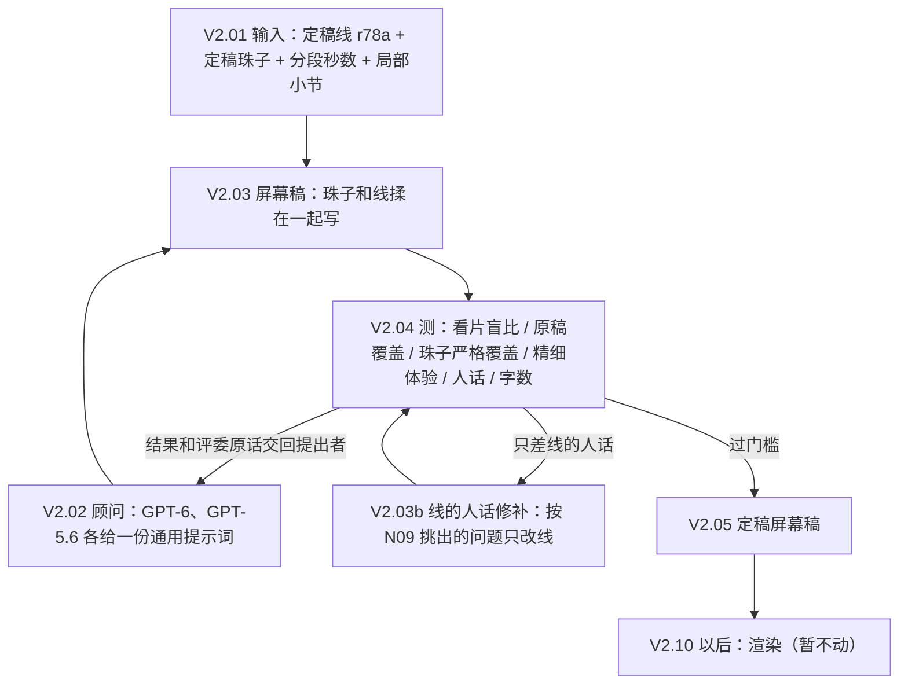

# DAG2：从定稿（线 + 珠子）到大众版视频

地位：视频这一段的现行流程。线和珠子怎么来，看 `_thread_evo_20261019/DAG.md`；DAG2 从那里的定稿接手。要做到什么，看 `_video_public_20261104/大众版标准.md`；用户原话看同目录的 `用户判定.md`。流程、提示词、模型、节点有任何改动，先改这里。

11-04 的 V1/V2（r54weave 全文上屏、节点加连线、三档右栏）已被用户否定，移到 `DAG2_历史_V1V2.md`，只作历史。

代码在 `D:\musicclaude\_video_public_20261104`（下表的脚本都在那里），提示词归档在本目录 `prompts/`。

**流程照 `_thread_evo_20261019/迭代准则.md` 执行（11-08 起，见其“DAG2 也照此执行”一节）。**

**现在只做内容段（V2.01–V2.05），渲染段（V2.10 以后）暂不动。** 用户 11-06：“目前应该都还没有到画面的时候吧……我们就现在停留在渲染前面 这都还是内容部分吧？”



## 内容段

| 节点 | 做什么 | 脚本 | 模型 | 提示词 |
|---|---|---|---|---|
| V2.01 输入 | 定稿线（r78a）、定稿珠子全文（带编号、角色、小节、是否局部）、每段秒数；把珠子按句拆成要点，供覆盖评审逐条判 | `pub2.py prepare`（新作品用 `op52_up.py src`）→ `r2/{作品}_src.json` | 无 | — |
| V2.02 顾问 | 两位顾问读标准、用户原话、测量结果，给写手一份通用提示词；之后每轮把结果和评委原话交回提出者，由他改提示词 | `pub24.py adv` / `revise*` | GPT-6、GPT-5.6（不用 Argon 当顾问，用户 11-05） | `prompts/V2.03_屏幕稿_顾问/` |
| V2.03 屏幕稿 | 写手直接读完整珠子和定稿线，一次写出一份上下交替的屏幕稿：线一行（标出要放大的关键词、一种情绪色），感受一行（碎片，每块注明来自哪颗珠子，只属于某几小节的写 bars）。两首同跑、同一份提示词 | `pub24.py write 候选` → `r3/s24/screen_{作品}_{候选}.json` | GPT-6（gpt3、gpt4 两个账号分流） | `prompts/V2.03_屏幕稿_写手/prompt_*.txt` |
| V2.03b 线的人话修补 | 只差“线的人话”时用：把 N09 评审对线挑出的单句问题和累积问题交给写手，只改被点到的线和累积问题的证据句；意思、关键词不变，不变长；感受碎片一字不动 | `pub24.py fixlines 来源 新` | GPT-6 | 提示词在 `pub24.FIXLINES` |
| V2.04 测 | 见下节 | `pub24.py test 候选` | GPT-6、GPT-5.6 两位评委 | `prompts/V2.04_*` |
| V2.05 定稿 | 两首一起过门槛的候选成为屏幕稿主线 | — | — | — |

脚本只做机械的事：替换占位符、核对感受的来源珠子编号、核对 bars 落在原珠子写明的范围内（不在就去掉）、只保留线里真有的关键词、统计字数。内容全部由模型写，没有人工挑选或改字。

### 屏幕稿的格式

```json
{"plan":"全曲怎么排、哪些词前后呼应",
 "sections":[{"sec":"S01","rows":[
   {"kind":"line","text":"线这一行","keys":["放大的关键词"],"emotion":"炽热|欢喜|亲密|安心|孤单|不安|悬着","from":["S01-1"]},
   {"kind":"feel","items":[{"text":"一个碎片","bead":"S01-B2","bars":"12–14 或空"}]}]}]}
```

rows 从上到下排。情绪七选一，同一条线下面的感受跟它同色。

### V2.04 测什么（都是两首 × 两位评委）

| 测法 | 问的是什么 | 现在的视频 w23 | 脚本 |
|---|---|---|---|
| 看片盲比 | 扮边听边扫的观众比新稿和现在的视频：扫得动、抓得到要点、知道为什么、前后是一件事、感受细。四位评委（GPT-6、GPT-5.6 各两次）× 两个座位 × 两种先后顺序，每首 16 次判断，按配对看（11-07 起，见修订记录） | — | `pub24.vs_one`、`vs_order.one` |
| 原稿覆盖 | 原稿（珠子要点 + 线）每条在屏幕上留住 / 部分 / 没有，线和感受都算 | 留住 70–76% | `pub_cover.py` |
| 珠子严格覆盖 | 只看屏幕上的感受，原稿珠子里那个具体的画面、身体感觉、比喻、心里话、转折还在才算留住 | 留住 45–86%（平均约 63%） | `pub24.bead_cov` |
| 精细体验 | 先由 GPT-6、GPT-5.6 各从原稿挑一次最精细、换个说法就没了的地方，合并成固定清单（op60 69 条、op61 58 条，`r3/fine_list_{作品}.json`）；每版逐条判在 / 变粗 / 没了，报“在”的比例（11-07 起） | 0.78–0.81 | `pub25.py` |
| 人话 | 线那边的 N09 开放评审，读两遍：只读线、读整屏；加句式统计。整屏那一遍 11-07 起用第二版提示词（按屏幕稿扫读来读，重复要同时满足同功能、无发展、增加负担才算，分严重 / 中等 / 轻微） | 定稿线 7.5–8 分 | `pub18.lang_one`、`pub24.lang_all`（`PUB_LA_CAL=2`，默认）、`pub18.meter` |
| 字数 | 全屏字数和现在的视频之比；线多少行、平均多长；感受多少块 | 1.0 | `pub24.py stats` |

送测前先过机械预检 `pub24.py precheck 候选`：感受是碎片（平均不超过 8 字、几乎不带逗号句号）、每条线有情绪色、总量不超过现在的 1.4 倍；不过就不送测。第九轮顾问整份重写后又写回整句、总量到 2 倍，所以加了这一步。

汇总：`pub24.py gate 候选` 按下面的门槛逐首对照现在的视频，两位评委取平均。

### 门槛（暂定，都和现在的视频比，两首一起过才算）

- 看片盲比（11-07 起按配对判）：同一评委、同一座位，两种先后顺序都选旧的（稳定选旧）必须为 0；五个分项（扫得动、抓要点、为什么、前后一件事、感受细腻）在 16 次判断里，新版赢的次数都不少于旧版。旧判法“8 票至少 6 票”作废：评委明显偏向后出现的版本，同一对版本换个顺序结论就变。
- 原稿覆盖、珠子严格覆盖、精细体验都不低于现在的视频。
- 人话：线不低于定稿的线（线一字不差的版本测量合在一起平均）；整屏的严重累积问题不多于现在的视频。中等条数只报不卡：放进一处明显重复做正向对照，四位评委都判中等，可现在的视频自己就测出 0.75–1.25 条，区分力不够。
- 感受是碎片（用户 11-06：“看起来完全不碎啊？还是句子？？”）。
- 注意力要经济：字数没有硬上限，但多出来的字只能给小字的感受，线要比现在短。

### 当前的屏幕稿主线（11-06）

g68L2，线是 r78a：用第八轮 GPT-6 的写手提示词（`prompts/V2.03_屏幕稿_写手/prompt_g68.txt`）两首同写，再按 N09 意见修两轮线的人话。两首一起过全部门槛：看片盲比 3/4、4/4；原稿覆盖 0.89、0.98（现在的视频 0.79、0.77）；珠子严格覆盖 0.93、0.98（0.55、0.72）；精细体验 0.45、0.73（0.30、0.40）；线的人话 7.75、8.0（定稿 7.75、7.75）。字数 1.1 倍，感受是一首 410–430 个碎片。产物：`_video_public_20261104/r3/s24/screen_{作品}_g68L2.json`。

**11-06 线换成 r79d 后重跑（`line_r79d/`），四版都没过，主线仍是上面的 g68L2（r78a）：**

| 版本 | 看片盲比 | 原稿覆盖 | 珠子严格 | 精细 | 线人话（定稿 7.75 / 8.0） | 没过的项 |
|---|---|---|---|---|---|---|
| g68（直接写） | 4/4、3/4 | 0.93、0.92 | 0.97、0.97 | 0.54、0.67 | 7.25、7.0 | 线人话 |
| g68L（修一轮线） | 2/4、2/4 | 0.93、0.91 | 0.96、0.96 | 0.79、0.65 | 7.75、7.25 | 盲比，op61 线人话、累积问题 |
| g68L2（修两轮） | 2/4、3/4 | 0.90、0.92 | 0.97、0.96 | 0.73、0.62 | 8.0、7.5 | op60 盲比、累积问题；op61 线人话 |
| g68S（严格修线，不许变长） | 4/4、2/4 | 0.91、0.90 | 0.97、0.97 | 0.66、0.62 | 7.5、7.25 | op60 线人话；op61 盲比、线人话、累积问题 |

现在的视频（w23）对 r79d 原稿：原稿覆盖 0.77、0.68，珠子严格 0.59、0.68，精细 0.37、0.27。覆盖三项每版都远高于 w23，卡在“线的人话”和“看片盲比”此消彼长：修线后人话上来，盲比就掉；每首只有 4 票，噪声大。r79d 的定稿线人话本身更高（op61 8.0），屏幕上的短线更难追平。严格修线的开关是 `PUB_FL_STRICT=1`，只在 `line_r79d/pub24.py` 里有；它没解决问题，所以没并回主脚本。候选 g68 导出在 `deliver_20261106/基于r79d_未过门槛/`。

**11-07 线换成 r79o（`line_r79o/`），按新测法和新门槛重判，还没有一版过：**

| 版本 | 怎么来的 | 稳定选新 / 位置敏感 / 稳定选旧 | 为什么（新:旧） | 前后一件事 | 扫得动 | 没过的项 |
|---|---|---|---|---|---|---|
| g68C2Y | g68 → 修线两轮 → 去跨段重复碎片（只动碎片） | 3/5/0、3/5/0 | 0:16、1:14 | 5:11、7:9 | 13:3、11:5 | 盲比 |
| g68W | 在 g68C2Y 上每段补因果，每条最多 +12 字 | 4/4/0、5/3/0 | 0:16、2:14 | 5:11、6:10 | 13:3、11:5 | 盲比；op61 线人话 |
| g68T（上限实验） | 感受照 g68C2Y，线换回定稿原文 | 5/3/0、8/0/0 | 9:7、16:0 | 13:3、16:0 | 3:13、1:14 | 盲比（扫得动） |
| g68RA | 感受照 g68C2Y，GPT-6 从定稿线重写屏幕线（`relines.py`） | 3/4/1、4/4/0 | 8:7、9:5 | 9:7、9:6 | 4:11、6:9 | 盲比；op61 线人话 |
| g68RB | 同上，GPT-5.6 写 | 4/3/1、8/0/0 | 9:7、11:4 | 10:6、15:1 | 3:12、11:3 | op60 盲比、线人话；**op61 全过** |
| g68RC | 同上，GPT-6 写，加“要真删”和每段字数参照（`PUB_RL_CUT=1`） | 5/2/1、6/1/1 | 6:10、12:3 | 12:4、13:3 | 3:11、4:12 | 盲比、线人话 |
| g68RD | GPT-5.6 写，行短且总量真减（`PUB_RL_CUT=2`；线约为定稿八成，平均 17 字一行） | 1/6/1、7/1/0 | 4:11、13:2 | 7:9、13:3 | 4:12、12:4 | op60 盲比；op61 线人话 |
| g68RE | 同上，GPT-6 写 | 2/6/0、6/2/0 | 4:12、9:7 | 7:9、12:4 | 6:10、8:7 | op60 盲比、线人话；op61 线人话 |
| g68RBF | RB 的线 + 按停留秒数删碎片，每段删到 w23 的字数（`trimfeel.py`） | 7/1/0、8/0/0 | 6:10、10:6 | 12:4、11:3 | 16:0、14:2 | 覆盖三项掉到 w23 以下（op60 覆盖 0.58）；op60 盲比；线人话 |
| g68RDF | RD 的线 + 同上 | 6/2/0、8/0/0 | 1:15、14:2 | 6:7、15:1 | 14:2、13:2 | 珠子严格；op60 盲比；op61 线人话 |
| g68RBH | RB 的线 + 删碎片只删超出部分的一半（`PUB_TF_HALF=1`） | 5/3/0、8/0/0 | 6:10、14:1 | 8:8、14:1 | 11:4、9:6 | op60 为什么；珠子严格 0.60、0.67（w23 0.61、0.69）；线人话 |
| g68RAH | RA 的线 + 同上 | 5/3/0、6/2/0 | 7:8、5:9 | 7:7、10:4 | 12:4、11:5 | 只差“为什么”（op60 差一票）和 op61 线人话 7.69（定稿 7.75） |

以下每首 24 次判断（`PUB_JREP=2`，三组评委）。加样本后 RAH、RBH 的 op60“为什么”是真输（8:15、9:15）。

| 版本 | 怎么来的 | 稳定选新 / 位置敏感 / 稳定选旧（共 12 对） | 为什么 | 前后一件事 | 扫得动 | 没过的项 |
|---|---|---|---|---|---|---|
| g68RGH | GPT-6 从定稿线重写，一行一个因果（`PUB_RL_CUT=3`，平均 30–33 字一行）+ 删碎片一半 | 12/0/0、11/1/0 | 21:3、19:3 | 23:1、21:3 | 10:14、10:12 | 扫得动；线人话 |
| g68RHH | 同上，GPT-5.6 写（平均 26–28 字一行） | 11/1/0、12/0/0 | 16:8、24:0 | 17:5、24:0 | 11:11、11:13 | **op60 全过**；op61 扫得动差两票、线人话 7.58（定稿 7.67） |
| g68RIH | GPT-5.6，一行一个因果且最多一个逗号（`PUB_RL_CUT=4`，22–23 字一行） | 3/6/0、12/0/0 | 8:13、14:9 | 11:10、22:2 | 9:10、14:9 | op60 为什么、扫得动 |
| g68RJH | 同上，GPT-6 写 | 4/7/1、10/2/0 | 5:19、20:4 | 11:10、22:2 | 13:10、8:15 | op60 为什么；op61 扫得动 |
| g68RHT | RHH 的线 + 碎片删到超出部分剩四分之一（快筛） | 11/1/0、12/0/0 | 16:6、23:1 | 21:3、24:0 | 17:7、12:8 | op61 线人话 7.58 |
| g68RHL | RHH 只修人话、不许变长（快筛） | 9/3/0、12/0/0 | 14:8、20:3 | 19:3、23:0 | 12:10、13:9 | 快筛两首都过（线人话 7.71、7.79），但修线改了原意（疑问改断言、具体说法变笼统、加了定稿没有的“谁也没法答应永远”） |
| g68RHLT | RHL + 再删碎片（快筛） | 8/4/0、12/0/0 | 15:8、19:3 | 16:6、23:0 | 14:9、11:10 | 快筛过，op61 扫得动只多一票 |
| g68RHM | RHL 把改了原意的 10 行改回（op60 3 行、op61 7 行） | 7/5/0、12/0/0 | 7:15、20:2 | 15:8、24:0 | 14:10、12:11 | **op61 全套全过**（线人话 7.67 = 定稿）；op60 为什么 |
| g68RHN | RHM，op60 S13 改回的那行主语不清（“越喜欢跟他待着”），改清楚；op61 逐字相同、复用测量 | 9/3/0、12/0/0 | 9:10、20:2 | 14:8、24:0 | 13:11、12:11 | op60 为什么差一票，其余全过 |
| g68RHP | RHN，op60 S13 原因和结果并进一行（定稿原话） | 7/4/1、12/0/0 | 12:11、20:2 | 16:6、24:0 | 11:12、12:11 | op60 扫得动差一票、稳定选旧 1 |
| g68RPT | RHP 两首再删碎片（超出部分剩四分之一） | 9/3/0、12/0/0 | 10:12、23:1 | 17:7、24:0 | 16:8、11:13 | op60 为什么；op61 扫得动、珠子严格 0.61（0.69）、线人话 7.60 |

一行一个因果是这一轮最大的进步：“为什么”从输变成大胜，稳定选新几乎满票。op60 的因果一拆就断（RIH、RJH 按逗号拆行后 op60 又输“为什么”），所以留在 RHH 的线上，补 op61 的扫得动和线人话：再删一轮碎片（超出 w23 的部分剩四分之一）、只按人话评委点名的问题修线且不许变长（`PUB_FL_NOGROW=1`），两首同步。

修线（RHL）让 op61 线人话过了，但有几处把意思改了，改回原意（RHM）后 op61 全套全过。op60 只差 3 行，“为什么”却从 14:8 掉到 7:15：评委点 S13“为什么想把心意藏回去”，因为改回的那行主语不清，“想藏回去”的原因（怕连这样待着都没了）和结果（少露些心意）也分在两行。RHN 改清楚主语后 9:10；RHP 再把那组原因和结果放进同一行（用定稿原话），“为什么”过了（12:11），扫得动又差一票。RHL、RHM、RHN、RHP 的 op60 只差几行，扫得动和为什么就在一两票之间来回，这是门槛边上的噪声，不再逐行追；改为加余量：快筛里只有再删一轮碎片能让 op60 两项同时拉开（RHT 17:7、16:6），所以 RPT = RHP 两首同步再删碎片（超出部分剩四分之一）。RPT 没用：op61 删了碎片扫得动反而 11:13，珠子严格掉到 w23 以下，说明扫得动这一项本身有两三票的噪声，删碎片已到头。

把只差几行的版本合起来看 op60“为什么”：RHH 的线（RHH、RHT）32:14；第一版修线后（RHL、RHLT）29:16；改回原意后（RHM、RHN、RHP、RPT）38:48。所以是修线这一步把 op60 的“为什么”拖回五五开，改回几行救不回来。下一版 RHQ：回到 RHH，两首用加了“守住意思”的修线提示词重修（`PUB_FL_NOGROW=2`：疑问仍是疑问、猜测不改确定、具体说法不变笼统、不加定稿没有的话、原因和结果一个不丢），先快筛。教训：修线提示词要写明疑问不改断言、具体说法不变笼统、不加定稿没有的话。

两首数字都按 op60、op61 的顺序写。原稿覆盖、珠子严格、精细三项每版都远高于 w23（覆盖 0.87–0.88 对 0.71–0.76，精细 0.95–0.98 对 0.78–0.81）。结论：压缩线输“为什么”，是因为压缩时删掉了原因、动机和转折；在压缩线上补字没用（g68W）；换回原文能赢回来，但扫不动。所以下一版从定稿线重写屏幕线（`relines.py`），原因留下，重说、修饰和感受碎片已经说过的删掉。

从定稿线重写后，“为什么”和“前后一件事”都赢回来了，卡在扫得动。线的总字数（定稿 op60 1527、op61 1377；压缩线 895、771）：RA 1524、1086（94、52 行），RB 1558、1112（81、61 行），RC 1342、1051（48、40 行，平均 26–28 字一行）。过了的 RB op61 是一行一个意思、平均 18 字、总量约为定稿八成；op60 三版不是总量贴着定稿（RA、RB 只是把定稿切成短行），就是又并成长行（RC）。下一版（`PUB_RL_CUT=2`）两首同时要求行短、总量真减。

RD、RE 的 op60 还是扫不动。逐段看：op60 全曲短（约 540 秒，op61 约 800 秒），每秒字数本来就高；评委点名的几乎都是 op60 S05（18 秒放了 259 字，w23 187 字）、op61 S08–S12 这类短段。所以扫不动主要是短段里感受碎片太密，不只是线。按秒数删碎片后扫得动翻过来（16:0），可删到 w23 的字数就删过头，覆盖三项掉到 w23 以下；下一版只删超出部分的一半（`PUB_TF_HALF=1`）。只删一半后（RAH、RBH）扫得动保住了（11–12:4–6），覆盖、精细回到 w23 以上，剩下的差距都在一两票、零点零几分：同一套线只删了些碎片，“为什么”就在 9:5 和 5:9 之间晃（RA→RAH op61），说明 16 次判断的噪声有三四票。门槛不放宽，改为加样本：再加一组重复评委（`PUB_JREP=2`，每首 24 次判断，线人话也多测两次），用同样的“新不少于旧”重判。op60 的“为什么”还输：评委说短句把因果连接切断了（“完整长句交代得更顺”），另有压缩走样（“对方也许需要他”写成“有时也需要”，S14 丢了“等真的到了那时再说”）。

### 线换了版本怎么跑

`bash _video_public_20261104/dag2_newline.sh 线TAG prep`，再 `bash dag2_newline.sh 线TAG run`。
- prep：在 `line_<TAG>/` 建工作副本，用新线的合写稿（`v6weave.py`）生成输入，不调模型。
- run：先把现在的视频按新原稿重测一遍基线，再用 g68 提示词写、修两轮线、每步全套测试，最后对照门槛。
- 所有模型调用编号都加后缀 `_L<TAG>`，不会命中旧线的缓存。

## 渲染段（暂不动）

| 节点 | 做什么 | 脚本 |
|---|---|---|
| V2.10 音乐数据 | 已对齐的 MIDI、小节表、录音 → 音符数据，校正起音 | `prep_music.py`、`align_music.py` |
| V2.11 明确指向 | 只有词本身指向某个声音时才给音上色 | `pub18.py explicit` |
| V2.12 画面 | 上下交替、关键词放大、情绪色；局部小节的感受到时出现（和“明确指向才上色”分开） | `film_v8.py`（试验） |

## 修订记录

- **2026-11-06：** 重写。旧 V1/V2 移入历史。内容段从“先拆词、再按匹配配线”（w23，`pub11/14/17/19`）改为屏幕稿节点：珠子和线揉在一起写，上下交替。依据是用户 11-05、11-06 的原话，以及 `_video_public_20261104/线的视频形态_1105.md` 里的八轮试验。新加两个测法：珠子严格覆盖、整屏人话。
- **2026-11-06（晚）：** 线换成 r79d 重跑，四版都没过门槛（见“当前的屏幕稿主线”下的表）。主线仍是 g68L2（r78a）。下一步要解决的是：屏幕短线的人话和看片盲比此消彼长。
- **2026-11-07：** 线换成 r79o。测法改三处，都先交给 GPT-6、GPT-5.6 独立问诊（`judge_check.py`，见迭代准则“评委矫正机制”），印证后再改：① 精细体验旧测法每次现挑句子、两次几乎不重合，换成固定清单逐条判（`pub25.py`）；同一版测四次相差约 5 个百分点内；删掉约四分之一精细载体的反向对照，分数从 0.97 降到 0.79。② 整屏累积问题换第二版提示词；放进一处明显重复的正向对照，四位评委都抓到了；中等条数区分力不够，改成只卡严重条数。③ 看片盲比有强烈的位置偏差（新版放后面 45/48 胜，放前面 22/48 胜），改成交换顺序、按配对判，五个分项各自不劣。新判法下，g68C2Y 和 g68W 只输“为什么”和“前后一件事”；上限实验 g68T 说明扫得动一项对字多会扣分（13:3 变成 3:13），不是评委偏差。
- **2026-11-08：** 用户指出方向偏了：“注意你这现在应该是要把珠子和线揉在一起的 连贯和散落都是可行的 我看你这个rhp的还是分开来的是什么情况”；“揉起来的目的就是为了让它这个内部能够更连贯，它读起来不会太跳跃 我们肯定是希望保留原来的内容，所以才需要去测和dag的覆盖率”；“dag和dag2应该是两套标准”；“异质性其实就是不啰嗦啊”。11-06 起的屏幕稿只做到排版交替，内容仍按来源分开（大字只放线、小字只放珠子，relines 还写了“不把珠子的感受搬进线”，珠子覆盖也只看小字），11-07 的迭代都在这个错的形态和不全的门槛上调余量。处理：① 大众版标准起草修订稿（`_video_public_20261104/大众版标准_修订草稿_1108.md`，待用户定）：和 DAG 分成两套，内容 5 条（扫一眼抓到、连贯不跳、定稿内容不丢、不啰嗦、人话），画面 3 条移到渲染。② GPT-6、GPT-5.6 独立体检迭代函数（`line_r79o/r3/gate_review_*.md`）：一致认为 w23 不能当合格线、意思走样要能查出、覆盖要看整屏并保住核心、门槛边上的噪声要另行处理。③ 新测法：整屏珠子覆盖（`PUB_BC_ALL=1`，大字小字都算，w23 同样重测）；意思走样（`faithful.py`，用 RHL/RHM/RHH 校准）；按新标准的两两盲比（`vs2.py`）。④ 揉在一起写稿（`blend.py`，每行自选连贯或散落，线和珠子的内容都能进任何一行），GPT-6、GPT-5.6 各一版（g68BA、g68BB）。⑤ 验证用户猜想“DAG 也没有必要把不啰嗦、人话做的特别好，反正 DAG2 会再做一遍”：r80b（比 r79o 更贴 Center、覆盖更多，但人话、不啰嗦输）和 r79o 各走同一条 DAG2，比成品（`line_r80b/`）。
- **2026-11-08（续）：** 两份标准经用户同意正式写入（DAG：`_thread_evo_20261019/标准.md`，只管内容 4 条 + “意思读得清楚”底线，可由我凭端到端证据改；DAG2：`_video_public_20261104/大众版标准.md`，7 条，只有用户能改）；不做小众版，DAG 定稿只作原料。新测法校准：① 意思走样（`faithful.py`）：RHL 修线改了意思的 3 处四位评委全抓到，另查出 1 处我漏改的；改回原意的 op61 只剩一位评委零星报；规则定为至少两位评委同报一处才算。② 新盲比（`vs2.py`）：同一版自比全为位置敏感、各分项全平（无偏向）；压缩线 C2Y 对原文线 T：扫得动、不啰嗦 C2Y 8:0，为什么、连贯、细腻、人话 T 赢，和已知结论一致，可以用。第二版门槛 `gate2.py`（走样硬门槛 + 整屏珠子覆盖不低于 w23 + 新盲比七个分项对 w23 不劣）。I02：两位顾问各出三套揉在一起的写稿提示词（K1–K6），快筛最接近的是 K3（GPT-6，两首盲比全赢、无走样，只差整屏珠子覆盖）和 K4（GPT-5.6，op61 全过，op60 为什么 1:7、1 处走样），按 I12 交回原提出者改（K3b、K4b）。
- **2026-11-08 06:45：DAG2 新标准下的第一条主线 g68K3A。** 来历：GPT-6 的“轨迹”写稿提示词（`line_r79o/r3/s24/prompt_BLg63.txt`，`blend.py`）+ 补覆盖层（`addcov.py`：只把评委判为丢了的珠子要点补成短短语，已有的字不动）。全套（6 位评委）两首都过 `gate2.py`：走样 0；整屏珠子覆盖 0.68/0.83（w23 0.67/0.74）；原稿覆盖 0.79/0.84（0.76/0.74）；精细 0.87/0.90（0.79/0.78）；整屏人话 7.17/7.33（7.17/7.08），严重 0；新盲比对 w23 每首 12 对，稳定选新 6、选旧 0，七个分项全不劣（op60 扫得动 12:0、连贯 8:4、不啰嗦 6:1、人话 11:1、为什么 10:2、单独成立 11:1、细腻 12:0；op61 全部 11:1 或 12:0）。交回顾问让写手自己补覆盖的两轮（K3b/K3c、K4b/K4c）都把覆盖做到近 1.0，但整屏写到旧视频两倍、不啰嗦全输：写手一被要求保住覆盖就逐颗扩写，补覆盖要放到写稿之后单独一层做。用户宽限：10:30 开始渲染。
- **2026-11-08 10:06：交付 K3A。** 两首整片渲染完成（`交付_20261108_K3A/`，Downloads `大众版_K3A_20261108.zip`）。渲染：本机内存紧（WSL 约 15 GB），整片一次渲染 MemoryError，改为 60 秒一段分段渲染再拼接、换完整原声（`out/大众版_K3A/render_chunks.sh`，并限制 OpenBLAS 线程数）。看片截图发现两处评委没抓到的问题：感受小字里写了小节号（两首约 56 处，如“148–151小节还含蓄试探”），感受很多仍是整句、短停留段偏密。下一轮：写稿提示词写明正文不写小节号（局部内容靠“到时出现”）并加机械检查；散落要真是短语。08:00 起 gpt3 连续报 UPSTREAM_UNUSUAL_ACTIVITY、gpt4 一直 HTTP 429（两边并发都开到 15 后约一小时出现），K3A2 和开放评审没测完，迭代暂停。

## 11-08 晚 收敛（不渲染阶段）——作废，见下节“11-08 晚到 11-09 凌晨”
- 用户原话：“你继续持续迭代吧 不用渲染 直到收敛”。收敛规则：连续两轮，每轮至少两个独立候选，都没有一首过线。
- 比较对象：g68K3M2（K3A 用精确去小节号做出，`nobar2.py`）。盲比对 K3A 6/6 稳定选 K3M2；幻想全套过线；船歌整屏珠子覆盖两轮配对 +0.021（过），整屏人话两轮配对 −0.188（GPT-6 −0.25、GPT-5.6 −0.125，两家同向，在灰区内）→ 按 11-08 新的测量误差规则记“待复核”（迭代准则“绝对分数项的测量误差”一节，两位顾问确认过）。K3A 已不过“正文无小节号”硬检查。
- 第一轮（都对 K3M2，分阶段快筛 `r3/stage.py`）：
  - K6aM、K6bM（顾问改写稿提示词，GPT-6 写）：A 阶段淘汰，船歌两位评委都稳定选 K3M2。评语：感受更细，但比喻叠加、反复阐释，扫读、简洁、单独能看懂这几项都输。
  - K3M2T2（去术语、不许变长）：C 没过。船歌选新 1/敏感 3/选旧 0，人话 8:0，精细 0:8，简洁 0:4；幻想精细 1:7。评委基本按座位选：去掉术语更像人话，但多处换成了笼统的“声音”，丢了辨识度。
- 第二轮：
  - K3M2T3（只换难懂术语，左右手、高低音照留，换时必须具体）：C 没过。船歌选新 0/敏感 3/选旧 1，精细 1:6，简洁 0:4，连贯 1:3；幻想精细 2:6，连贯 0:4。
  - K7M（同一写稿提示词 BLg63n，换 GPT-5.6 写）：B 淘汰。幻想 S10 把珠子里“疲倦的人回想往事”的比喻写成了他本人的经历，两位评委同报严重走样（已核对属实）。
- 剩下的中等以上问题（K3M2 的开放评审和整屏人话评审，两首都有）：
  1. 感受行常写成完整长句、一条里叠两三个比喻再加解释，短停留屏（船歌 S05 18 秒，幻想 20–28 秒的屏）读不完。多位评委报严重。
  2. 同一屏用几个相近比喻反复说同一种感受；船歌“时间留不住”“不再藏喜欢”跨屏重复总结；水波、小船意象用得过满。
  3. 感受常从音乐结构、声部、技法讲起，或用分析式、抽象书面词（幻想报严重）。
  4. 结构上常是先讲完他的事、再列一组感受，没有真正揉成一件事（幻想 GPT-5.6 报严重）。
  5. 偶尔把感受扩大到故土、家园这类宏大意象，或补出原话没有的确定结论（幻想）。
- 卡住的地方：第 1、2、3 条每次去改都会在“感受细腻”上输（事后删减、补覆盖、去术语、打碎、写稿层往细里加都试过：要么细腻 0:8，要么简洁、扫读输）。这是大众版标准里“扫得动、不啰嗦”和“细腻、不丢”之间的取舍，要用户来定口味。
- 提速：分阶段快筛（明显输的十几分钟内淘汰）；每个账号在途 8（20:13 起试，至今没有报保护信号）；分段测覆盖校准没通过，不用。


## 11-08 晚到 11-09 凌晨：收敛标准纠正、测法修正、局部修改系列
- 用户原话：“你是说目前的标准真的有冲突吗 不能一起满足？”“对啊 所以你现在的收敛标准有问题呀 你实际做出一个剩余的问题都是很微小的再给我看”；11-09 00:30“给你九个小时去做”。
- 测法修正（都经两位顾问问诊、校准）：
  1. 盲比 vs3：细腻只看留下的说法具不具体、不看多少；不啰嗦看信息是否重复；允许判平。校准：同版对同版全平；只加近义重复的对照稿细腻平、简洁 0:8；具体换成“声音”细腻 0:8。
  2. 覆盖 cov3（units.py）：意思单元 + 核心 / 重要。和旧覆盖、核心要点覆盖三种口径一起看。
  3. 绝对验收 openabs（r3/openabs.py）：旧开放评审没有绝对轻重尺度，每版都报 5–13 条中等以上，同一版重测严重条数 5→2；新版按固定绝对尺度（严重 = 看不懂关键经历或读不到主干；中等 = 明确额外理解成本；轻微 = 能看懂、可更好），只是还能写得更好的不算问题。
  4. “到时出现”的描述错了：渲染器（film_v8）是到时出现、之后留到这屏结束，评委提示词写成“只在那几小节出现”；改正后（vs3b、openA2），幻想“到时出现的长句读到一半就消失”这条中等问题消失。
- 局部修改的规律（盲比证据）：只删整句多余的感受、留下的字一个不动能赢；压缩改写丢质感（细腻 0:8）；删心里话、“却”字转折丢为什么；把连着的心理过程拆开丢连贯；删话（大字）里的小句为什么 0:8、覆盖垮。
- 写稿层大改 K10a/K10b（顾问据上面的问题改写稿提示词，线和珠子揉进同一句）：连贯、为什么、单独成立大赢，但太长（4500–4900 字）、扫读和简洁输；揉的时候把听众的比喻写成了他的经历，走样 5–7 处。K10c（交回 GPT-5.6 第二次改：“位置上揉在一起，身份上不合并”）没有走样，但写到 5800–6400 字，扫读、简洁、单独成立 0:8。写稿层收不住篇幅，先放下。
- 当前最好的一族：K9e（cut.py 只删感受里多余的小句 + 修接缝，整屏约 2900 字）→ K11（再把船歌第 5 段 18 秒 222 字收到 135 字）。
  - K11 对 K3M2 盲比：船歌 4/4 稳定选 K11，幻想 2 稳定、2 随座位；扫读、连贯、简洁赢；船歌人话 1:6（第 5 段压成电报腔，K11c 已改）；幻想为什么 0:6、单独成立 0:5、细腻 0:7。
  - K11 绝对验收（两首 × 两位评委 × 两遍 = 8 次）：严重 0；8 次里 7 次没有中等，1 次报 2 条中等（都在船歌第 5 段：一句压得别扭、时间仍紧）；轻微共 24 条。
  - 覆盖：意思单元口径船歌核心 0.856（w23 两次 0.676/0.794）、幻想 0.826（w23 0.819/0.894）；旧覆盖和核心要点覆盖明显低于 w23。
- 正在做：K11d = 按评委在盲比里点名说丢了的内容回补（每首最多 8 句）+ 修接缝 + 第 5 段收紧（不许电报式）。
- 11-09 05:20 交付 `交付_20261109_K11g/`（Downloads：`大众版屏幕稿_K11g_20261109.zip`），未渲染。
  - K11g = K3M2 → 只删感受里多余的小句（cut.py，放大词、心里话、“却”字转折受保护）→ 修断口（cut.py seam）→ 按评委盲比点名回补（restore.py，V2 能放回整块删掉的块）→ 过密屏收紧（dense.py V3：因果对比不删、画面不压缩）→ 语病微修（fixlang.py，每处 ≤4 字）。
  - 对 w23：两首 8/8 稳定选新，七项几乎全 8:0。对 K3M2：8/8 稳定选新；细腻两首 0:4、幻想为什么 0:2。绝对验收 24 次：严重 0，中等 13 条（都是某屏偏密，重复的只有船歌第 5 段和“小字长句”两类），其余轻微。没有走样。覆盖：意思单元口径与 w23 相当（船歌“重要”层和旧口径偏低）。
  - 再往短里删（K11d 压第 5 段、K12 删长感受块）都输“为什么”、丢覆盖，所以停在 K11g。
  - 写稿层重写 K10a/b/c：揉得好但写到 4500–6400 字；K10c 的“位置揉在一起、身份不合并”规则消除了走样，可留作以后写稿层的规则。
- 交付后补试（都没超过 K11g）：K12 删长感受块（幻想为什么 0:8）；K13 给长感受块加锚点（扫读赢、连贯输，中等问题 9→14）；K14 再收紧三屏（船歌 4/4 稳定选回 K11g）。K11g 是平衡点。
- 11-09 12:10 K11g 两首整片渲染完成（与 K3A 同渲染器、同分段做法），放入 `交付_20261109_K11g/`，Downloads `大众版_K11g_20261109.zip`。
- 11-09 下午更正：K11g 不是收敛，只是 K3A 删短（新写字 22/36），仍有 13 条中等问题；DAG 未按 11-08 标准测或迭代。
- 11-09 下午 K15（写稿层重写 + 每屏按停留秒数定字数上限，每秒 5.5 字、90–300 字；`blend.cap`、`refit.py` 超上限并行重写；提示词 `prompt_BLg65a.txt` = K10c 的“位置揉在一起、身份不合并”规则 + 字数硬上限 + 打碎成短语）：两版都在上限内（船歌约 2500、幻想约 2600），但写成了线照抄 + 珠子切碎（幻想 147–175 块散落，“后来”“接着”单独成块，留着音型描写）。分阶段快筛 A 就淘汰：K15a 船歌、K15b 幻想两位评委都稳定选 K11g。评委理由一致：K11g 把感受织进人物经历、更连贯；K15 在人物故事和感受清单之间来回跳，近义短句堆叠；K15 只赢扫读。→ K16：散落每块要是完整小意思、不切句、不写音乐本身；大字不照抄线，把对应珠子的感受揉进处境（DAG r2c 写明了对应）。
- 11-09 下午 K16（DAG r2c 当原料 + 写稿时带上线和珠子的对应；散落每块要完整、不写音乐本身；大字揉进对应珠子的感受）：K16b 盲比快筛 A 过（两首都被说更连贯，“把感受融进叙事”做到了；输在细腻——具体说法被改成概括、扫读——K11g 放大词更醒目、“也可以听成”太多），但 B 淘汰：船歌旧覆盖 0.44（w23 0.665）。对照字数分配：w23 大字 1583 / 小字 1063，K11g 1591 / 1465，K16b 2041 / 429——揉得多就把珠子挤掉了，小字又是改写。K16a 船歌写稿通道故障在重试。→ K17：每屏另给大字上限（55%），小字用珠子自己的原词写成 3–10 字短语、一颗取一两块、不加“也可以听成”说明语（`prompt_BLg67a.txt`，`PUB_BL_BIG=0.55`）。
- 11-09 下午 K17（大字最多 55%、小字取珠子原词 3–10 字）：两版篇幅像 w23（船歌约 2200、幻想约 2500，大字小字约 55:45，珠子基本都用上），但快筛 A 都淘汰（船歌两位评委都稳定选 K11g）：小字像一串意象清单、近义短语重复，具体感受被压泛。从头重写六版（K15–K17 各两版）全部输给 K11g。→ 按迭代准则 I01 交给两位顾问独立诊断（`r3/adv_k18.py`：为什么重写总输、走从头写还是以 K11g 为底逐屏重组、测法有没有让重写吃亏、给出完整提示词）。
- 11-09 下午 两位顾问（`r3/s24/adv_k18_{g6,g56}.json`）独立给出同一路线 B：以 K11g 为底逐屏重组（允许每屏大改：重排、合并、改写、换形态），K11g 的长处是 K3A 第一次融合就排好的叙事骨架和线—珠子对应，从头写每次要同时重解四件事、修一项丢另一项；13 条中等问题是局部的，适合逐屏修。GPT-5.6 加“先锁定每屏在全曲的叙事职责，再动局部”。测法两位一致：绝对验收严重 0、中等 0 + 覆盖不丢核心为第一道门槛；盲比保留、允许平、作辅助；字数上限只作上限。两位都建议真人在真实视频上测扫读（这里做不了，交付时说明）。K18a（GPT-6 提示词，`prompt_BLk18a.txt`）、K18b（GPT-5.6，`prompt_BLk18b.txt`）各写两首，流水线 `r3/pipe_B.sh`（绝对验收和盲比同时跑，都报）。
- 11-09 傍晚 K18b（GPT-5.6 路线 B 提示词，每秒 5.5 字上限）：盲比快筛 A 淘汰（船歌两位评委稳定选 K11g：大字被压成生硬短句、S06–S07 重复同组感受）；绝对验收 8 次严重 0、中等共 4（与 K11g 的每次约 0.5 条相当），中等仍全是“小字是多层长句、积在同屏扫不完”（标准 7）。判断：① 每秒 5.5 字的上限逼着从 3060 字的 K11g 再删一成，正是 K12/K14 输“为什么”和连贯的原因；评委报偏密的屏都在每秒 7 字以上，上限改 6.5。② 所有版本共有的中等问题出在小字的形态（一条装多层意思），删字解决不了。→ K18c（K18b 提示词 + 小字每条一个画面、约 18 字内、多层意思拆短条或写进大字；大字不压短；6.5 字/秒）；K19（`reshape.py`：K11g 上逐屏只改形态不删内容，长小字拆成各自完整的短条或写进大字）。K18a（GPT-6 提示词）两首调用 30 分钟超时，重试中。
- 11-09 傍晚 K18c（小字拆成每条约 18 字的短条）：一屏 10–17 条，绝对验收 8 次里 7 次报中等（条数太多、积在屏上），盲比船歌两位稳定选 K11g（像意象清单）。K18a 船歌三次调用都在 30 分钟超时，作废。结论：长句扫不动、拆短条又太多，每屏能放的感受总量有限，单靠写法解决不了，删又丢“为什么”和覆盖。→ 呈现层：依次出现（`reveal.py`：内容一字不动，每行大字、每条小字按阅读顺序和字数比例给出现时刻 at，铺在这一屏前 85% 的时间；标了小节的照旧到时出现）。评委文字稿（`pub24.view_text`）标出“第几秒出现”并说明规则；渲染器 `film_v8.py` 加了相同行为（到 at 淡入，小字加亮 4 秒，留到屏末；备份 `r3/film_v8_备份_1109依次出现前.py`），未渲染（用户：先不要渲染）。用户 11-08 原话：“我们不是应该更精细的会给他做动画吗 然后也没有试要不要打碎？”。先测 K11gT（= K11g 内容 + 依次出现）看第 7 条的中等问题会不会消失。
- 11-09 晚 用户怀疑评委：“不是啊 你确定吗 你要么给我几个例子 我担心你的评委有问题 因为它这个是要一眼扫的呀 你这不拆我感觉肯定不太对”。给了船歌 S06 四版对照（K11g 长句 / K19 按逗号机械切 / K18c 15 条 / w23 核心短语）。按评委矫正机制问诊（`judge_check/scanbias.md`，结果 `scanbias_A_{g6,g56}.txt`）：两位顾问独立认为评委有系统偏差——它读完整文字稿、可反复读，测的是“通读哪版舒服”，不是“第一眼抓到什么”；K11g 的长句通读是优点、扫读是负担；但 K18c 说明条数太多同样扫不动，目标是少量、自然、独立的体验单元（w23 方向）。改法一致：评委看每屏真实截图（含出现时刻的几个状态），先只评首眼扫读、再评通读维度且不得推翻扫读；flow/human 不再因短语扣分；用自比判平、K11g/K18c/w23 三个已知样本校准；LLM 不能真正限时 3 秒，最终要真人看片。gpt3/gpt4 调用支持附图（`evo.call(attach=...)`）。
- 同时：K19 绝对验收中等 3/4/… 明显变多（按逗号切开反而更糟），淘汰。K11gT（K11g + 依次出现）8 次中等 3（K11g 每次约 0.5）。K20（`frag.py`：大字不动、小字改成核心短语）生成中。
- 用户又提：“这种 原先那个小节的 然后这种左手的 我觉得应该都是能够去对应到可视化的旁边的吧 可以给可视化的旁边划一块区域啊 我说的细致的不就应该在这里吗 不是一定需要去混到主段落中吧”。→ K21（`notes.py`）：上半屏小字只放核心感受短语（3–10 字，每屏 ≤ 秒数/5 块）；对着具体小节、具体声音的细致感受放到可视化旁的“旁注”（6–18 字，带小节，到时出现），数据 `section['notes']`。
- 11-09 晚 用户：“可以渲染了 然后你说的上半屏小字指的是什么 我不觉得珠子就天生应该更不重要啊 珠子很有可能就也是为线来offer的前提啊 我在想你这目前出的这种迭代问题 如果是评委问题 你也应当去校准一下评委”；“就是‘素材摘录’‘感受清单’这种 我们要做的目标 不是应该很清楚了吗 这本身没办法反驳我们的目标 我们的目标就是比如一眼要能扫过去 然后读起来要感觉能串起来这种”。
  - K21 第一版（大字不动、珠子只进小字或旁注）把珠子当次要，停掉；改为大小按这一刻的重要性定、不按来源，珠子是前提时进大字，旁注只放对着具体声音、具体小节的细节。
  - 截图评委 `r3/scanjudge.py`：正式渲染器每屏截三个时刻（约 3 秒、中间、结束前 1 秒），评委每次只看一个版本一屏的三张图，按两条目标打分：一眼扫得过去（score 0–4）、扫到的串得起来（link 0–4）；“是短语还是整句、像不像清单”本身不算好坏。截图时发现我 11-09 改 film_v8（依次出现）时把一行的高度累加误写进了注释，导致文字压到音乐区；已修，截图全部重截（视频没渲染过这一版，不受影响）。
  - 校准：K11g 两遍（同版稳定性），K18cM（太碎）、w23S（旧视频核心短语，转成同一渲染器格式）；候选 K20（大字照 K11g、小字核心短语，`frag.py`）、K20T（K20 + 依次出现）、K11gT。
- 11-09 18:45（接手会话）K21b 读第一份产物即停：上半屏比 K11g 更长（船歌 3557 对 3056 字、幻想 3296 对 3213 字），另加旁注约 1380 字；每屏最长一块 100–210 字（船歌 S05 一组大字 212 字，还写了“音乐却仿佛自己松开了手”），第 7 条（长段扫不动、不写音乐本身）比 K11g 更重。没跑测量。按重要性定大小、旁注区这两个想法本身没被否定，问题在写手把同组的线和珠子并成了长段。
- 11-09 18:40 通路：Docker 18:26 已恢复，新进程 gpt3 探测 5 秒正常；旧会话 17:34 起的截图评委进程仍零秒失败（rc=3221225794，进程启动失败），缺的屏等它们这一遍结束后由新进程补跑（已有结果自动跳过）。

## 11-09 晚（接手会话）：两层一起诊断、K22 四套、测法第三版
- 通路：18:49 那批截图评委零秒失败，是四条流水线各 12 线程同时起 `docker exec`、进程起不来（0xC0000142）。`scanjudge.py` 改 8 线程、加“连续 6 次零秒失败就停”。截图评委结果在 `_video_public_20261104/r3/s24/scanA_*`。
- **截图评委校准没通过**：同版两遍稳定（K11g 3.00/3.00），但 K11g、K18cM、w23S 几乎全给 3 分（w23S 2.85–3.0），分不开。看截图：三个样本大字都是两三条多层长句，量尺上端没有正样本；评委的文字描述看到了问题（“两段大字长句争夺注意力”）仍给 3。另有 7 份回复说没收到图（作废）。处理：造量尺两端的人造对照（`r3/ctl_scan.py`：SP 只留放大词 + 三个短块；SL 整屏一段）只测 5 屏；同时走矫正机制（`judge_check/scancal.md`）。暂不能当门槛。
- **I02（`r3/adv_k22.py`）**：GPT-6、GPT-5.6 独立诊断，差距大致线 30%、写稿 30%、形态 15–25%、测法 15–25%；都认为线要改——Center 两样缠在一起，来回本身不错，错在每次回来没有新东西，应螺旋往深处走；都认为旧绝对验收太松（读全文、不逐屏）。
- **绝对验收第三版**（`r3/openabs3.py`，两位顾问共同改法：逐屏、先写“比前面新知道了什么”、打转 / 分开 / 跨屏重复 / 多层长句 / 讲音乐本身不许降为轻微）。校准（`r3/ctl.py` 只改一处的对照）：K11g 每次中等 16–37（旧版 8 次合计 4）；打转对照 CL 认出（无新东西 1–2 屏、标准 1 问题增加）；笼统对照 CV 认出（标准 6 大增）；分开 CS、去音乐 CN 区分弱；同版两次条数差近一倍。用法：诊断 + 粗门槛，条数只配对多遍比；标准 2、7 灵敏度不够。
- **K22 四套**（写手都是 GPT-6，只差提示词，`r3/pipe_K22.sh`）：K22a（GPT-5.6 P1，只改写稿）、K22b（GPT-5.6 P2，改线 `r2k22b` + 写稿）、K22c（GPT-6 P1，改线 `r2k22c` + 写稿）、K22d（GPT-6 P2，只改写稿、体验主导）。两份提示词被泛化检查拦（“没有完全相同”“身体的感觉”，通用规则用语误撞作品字），同义替换后通过。
  - I04a 我读第一屏就停，都没测：旁注写成 60–200 字的整颗珠子搬运，带小节号和调性、声部描述；全曲 3800–4700 字（K11g 约 3100）；小字仍是带分号的多层长句。原因之一是我给顾问的材料没写版面容量（旁注区一行约 30 字；主区舒服字号下一屏约 120–180 字）。→ I12 交回提出者（`r3/adv_k22r.py`），补容量。
  - 改线：K22c 的线骨架没变、写成解释腔、变长（船歌 1529→2276 字），对应把后面段的珠子挂到前面；K22b 的线一条一个意思、句子短，骨架同样没变（“对方没退开”仍出现四次）。两套都以原线为输入，模型守着原骨架。要改“往哪走”，可能要回到经历骨架层（N05a）。
- **11-09 晚 用户纠正形态、替换标准**：扫得动 = 只看放大的东西就能拼出在表达什么；一块里不能有的字大有的字小，强调只用颜色、粗体；不按来源分大小；一颗珠子里不同听法不是重复；不啰嗦指逻辑简单。大众版标准换成 8 条（用户同意）。K23b（整句里放大几个词、线大珠子小）被用户否：人话退步、不是碎块、仍按来源分。
  - K23 带旁注重测（`g68K23bN` 等；第一次重跑读了调用缓存，作废）：绝对验收第三版中等 船歌 24/19、幻想 10/13（K11g 21/31、25/26）；意思单元核心留住 0.32/0.22（K11g 0.83/0.82）；K23c 0.42/0.43。走样：K23b 幻想 S06 一处（担心写成已经发生）。结论：扫读变好但内容丢一大半，形态也不对，不往下走。
  - 测法：文字稿（`pub24.view_text`）补上旁注；骨架测 `r3/skeleton.py`（只给放大的字让评委拼，再对完整稿打 0–4；对照 SR 随机放大词）校准中；绝对验收第四版 `r3/openabs4.py`（新编号、给 Center 判“核心看得出”），待校准。
  - 写稿：碎块格式 `r3/fragwrite.py`（大块 ≤14 字、块里不用逗号分号、强调只变色、整屏 uniform；小块 ≤18 字挂在大块后；机械检查不过自动退回重写，最多 3 次）；渲染器 `film_v8` 加 uniform（强调只变色不变大）、旁注可按珠子要点时间出现。I02 `r3/adv_k24.py` 两位顾问各写一份碎块提示词，补了用户硬规则“不同听法各自成块”；K24a（GPT-6 提示词）、K24b（GPT-5.6）在写。
- **11-09 22:40 覆盖测法漏洞**：`units.py` 用的 `feel_screen` 只在 `PUB_BC_ALL=1` 时给大块，旁注从不给；K23/K24 的流水线没设，覆盖只算了小块。改为 `units.py` 默认整屏、`feel_screen` 加旁注，换标签重测。**更正**：K23b 核心留住 0.75/0.65（不是 0.32/0.22）。
- **K24b**（GPT-5.6 碎块提示词，GPT-6 写，原线 r2c）：骨架测 3.71/3.50、3.69/3.85（K11g 3.1/3.0、3.5/3.6），没有 ≤2 的屏；绝对验收第四版中等 17/18、13/14（K11g 36–43、22–43），严重 0；和 K11g 盲比两首都 2/2 稳定选 K24b；覆盖核心 0.81/0.78、确认丢失 4/0（K11g 0.83/0.82、12/8）；走样两位同报 船歌 1、幻想 2。剩下：短屏太密、小块讲音乐、小块重复大块、抽象标签、去逗号连成串、几处走样、跨屏重复、大块几乎全是线。→ I12 交回 GPT-5.6（`r3/adv_k24r.py`）。
- 绝对验收第四版校准：K11g 两遍 36/39、43/40、25/40、43/22（条数噪声大）；打转对照 CL 认出（无新东西 2 屏）；笼统对照 CV 条数不稳定（21–60）。用法同第三版：诊断 + 粗门槛，只配对多遍比。
- 截图评委第二版：稳定（K11g 2.1/2.2），但整段对照 SL 2.1–2.5 不低于 K11g，没过校准，只作参考。骨架测校准：K11g 两遍稳定；随机放大词对照船歌分得开（2.4 对 3.1）、幻想弱（2.9–3.2 对 3.5）。
- K24a（GPT-6 提示词；第一次写稿时提示词写成“一次写两首”，写手反问，改成“这首”后重写）：船歌 2337、幻想 2308 字，用上了依次出现；旁注偏多、和小块重复。快筛在跑。
- **更正（22:50）**：`vs2.py A B` 里 A=K11g，报告“稳定选 A”是选 K11g。K24b、K24a 的盲比我读反了：实际两首都稳定选 K11g（K24a 幻想一位随座位）。理由里对得上新标准的：旁注/小块/大块重复同一画面、有些细节被说粗、大块小块交替在叙事和情绪间跳、有的碎块像提纲；和新标准相反、不算的：“完整句子更连贯”“关键词有字号层级”。盲比评委（vs3b）还是旧标准的分项，标准改了要跟着改、重新校准（待办）。第 1 次交回 GPT-5.6 的材料里这条写错了，第 2 次更正。
- K24a 快筛：骨架 3.43/3.64、3.77/3.54；绝对验收中等 12/17、16/8（幻想严重 2）；覆盖核心 0.85/0.86、确认丢失 4/2（好于 K11g）；走样两位同报 0。→ 交回 GPT-6（`r3/adv_k24r.py g6`）。
- K24b2 = GPT-5.6 第 1 次修订（`prompt_K24r1_g56.txt`），在写。
- **盲比第四版 `r3/vs4.py`**（分项照新 8 条；如实说明两种格式、格式本身不加减分；给 Center）。校准通过：K11g 自比全平或随座位、分项 0:0；对打转对照 CL 选原版（big 4:0、core 3–4:0、concise 4:0）；对笼统对照 CV 选原版（fine 4:0、small 4:0）。以后退步检查用它，vs3b 停用。
- 第 1 次修订结果（K24b2 = GPT-5.6，K24a2 = GPT-6）：绝对验收中等 K24b2 8/12、16/12，K24a2 11/17、23/24；骨架 K24b2 3.43–3.77，K24a2 3.36–3.92；覆盖核心 K24b2 0.75/0.78，K24a2 0.71/0.84；走样两版都剩结尾一屏“不再逼对方保证”。盲比第四版对 K11g：大块 K24 赢，核心看得出、人话 K11g 4:0，小块 K11g 赢（K24a、K24b2）。判定：大块和扫读进步，但核心线在碎块间断开、碎块像标签、小块复述大块，对得上标准第 2、3、5 条 → I12 第 2 次交回两位提出者。
- 第 2 次修订（11-10 00:00 前后；GPT-6 提示词里一条贴近作品原句的走样例子“舍不得什么”被泛化检查拦下，删掉该条）：
  - **K24a3**（GPT-6）：盲比第四版对 K11g 船歌 0 稳定（2 随座位）、**幻想 2/2 稳定选 K24a3**；分项 big、load、fine、concise K24a3 赢，human K11g 4:0，core K11g 小胜。绝对验收中等 20/23、12/17，严重 0；骨架 3.43/3.71、3.62/3.85；覆盖核心 0.78/0.81；走样两位同报各 1（船歌 S11 “他需要对方、对方有时需要他”抹平成“彼此有时都需要”；幻想 S03 听者的想象写成“他暂时绕开伤口”）。第一个过了退步检查的碎块稿；没过：走样硬检查；覆盖对 w23 待同口径配对重测；人话盲比 4:0 输。
  - 机械检查加：大块只来自珠子又用“他”当主语的退回（珠子写成他的经历，K24 各版反复出现）；小块无停顿门槛 12→16 字。
  - K24b3（GPT-5.6）：船歌第 3 次重写时 JSON 坏了，换前缀单独重写中。
- **K24b3**（GPT-5.6 第 2 次修订）：绝对验收中等 10/15、15/14（目前最少）；骨架 3.50–3.77；覆盖核心 0.87/0.78；走样两位同报 船歌 1（结尾“逼对方保证”点名后仍在）；盲比第四版 船歌一位稳定选 K11g、幻想随座位（过退步检查），core、human K11g 4:0。
- 覆盖对 w23（同口径两次）：船歌 0.71/0.83（同版差 0.12，噪声大）、幻想 0.89/0.90。K24 各版船歌不低于 w23，幻想 0.78–0.81 低于 w23（K11g 0.82 同样低于）。幻想覆盖是硬检查缺口；丢失的核心单元里不少是讲音乐的（核心层偏宽）。
- 第 3 次（最后一次）交回：每位顾问给整篇重写 + 局部修补两份提示词（`r3/adv_k24r.py`，`K24_REPAIR=1`）。重写提示词里有顾问照抄我给的走样例子（作品原句），泛化检查拦下，删掉或改成通用说法；修补提示词漏了 {ISSUES}，在末尾补上。修补执行 `r3/fragrepair.py`（被点名的问题 = 绝对验收中等以上 + 走样 + 确认丢失的核心单元）。K25b/K25bR（GPT-5.6）、K25a/K25aR（GPT-6）在写和测（`r3/pipe_K25.sh`）。
- 11-10 03:50 K25（碎块第 3 次、最后一次交回）结果：
  - 修补版 K25aR、K25bR：中等问题再降一半（4–10 条），但覆盖掉到 0.69–0.75（来源版 0.78–0.87），船歌 S13 各新出一处走样（两位同报）。修补拿内容换问题数，不收。
  - 重写版 K25a（GPT-6）：走样 0；覆盖 0.84/0.85（高于 K11g，幻想仍略低于 w23 的 0.89/0.90）；中等 20/10、12/5；骨架 3.6/3.7；过退步检查。没过：盲比 human 4:0、core 4:0/3:0 输 K11g；短屏偏密（幻想 S11 每秒 6.2 字）。本轮最好，但不是剩余问题都很微小。
  - K25b（GPT-5.6）船歌写稿传输失败重跑中。
  - 交回已到上限 3 次。下一步按 I02 回顾问换方向，主攻“人话”和“核心看得出”（碎块之间断开、像提纲）。
