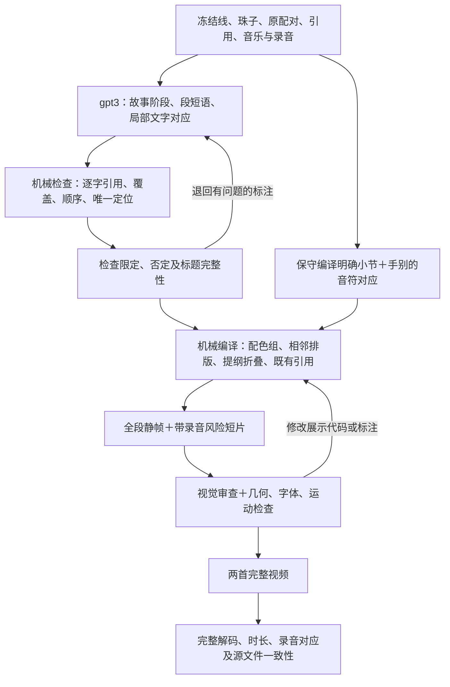

# DAG2：r54weave 展示与视频流程

**2026-11-04 用户纠正后的当前入口为V2。下文旧版规则属于V1历史。** V2取消了“全部文字全段同时显示”和“只显示过去音符”的旧实现：用户要求局部珠子按原定位出现，并严格仿Op52将现在放在中央，左右显示过去与未来音乐。所有画面定位信息删除。全文的原始版本及其显示字符映射保留；不改写原定稿。

V2接口：`v2_data.py compile`恢复机器图；`v2_data.py outline`一次压缩右栏标签；`v2_data.py timing`标注局部原文分块；`film_v2.py`排图与调用原BALLS音乐渲染规则；`v2_qa.py`检查定位删除、文字原分块完整、时间窗口、布局、实际静帧和编码后全片。阶段折叠密度0/1/2分别表示只显示当前短语、当前与上一短语、当前阶段已走过的全部短语。V2脚本与产物另存，不覆写V1或原ZIP。

V2复现时，已有模型输出应直接复用，并通过 `v2_data.apply_timing` 重应用已收取JSON；不要为了重新渲染重复发起已完成的标注请求。完整渲染命令：`python film_v2.py render --work op60`（另以op61运行第二首）；检查 `python v2_qa.py text`、`examples`、`review`、`media`。模型图片检查必须确实收到图，文字备用通道不合格。

局部标注的6处修补以 `runs/v2_local_timing_repair/parsed.json` 为准。重编译图后，用 `v2_timing_repair.apply(read(ROOT/'runs/v2_local_timing_repair/parsed.json'))` 一并应用初稿和修补；它只读取缓存，不发模型请求。

静帧审查拦下过粉色状态中心时刻不清的问题：音符间隙本就可能没有发声球，不能靠伪造音符解决。现版加始终可见的中央竖线及底部时间标记，发声球另按实际音符。已经在途的基础画面通过 `v2_finish.py` 叠加32px宽时间标记并使用本机已验证的QSV编码，音频仍直接复制，原基础成片保存于 `experiments/v2_base/`；后续用最新版 `film_v2.py` 新渲染时直接包含此标记，不重复叠加。阻断原评审与实际编码修补图的复审分开保存。

本目录从已经收下的 r54weave 开始，只制作展示层。原内容 DAG、写线流程、标准和已交付 ZIP 均不在本流程的写入范围。用户在本聊天明确选择 r54weave 作为视频内容，并要求以 Op.52 旧视频的框架先做基础版，相关文字摆近，再补局部颜色和有层级的提纲。

设计依据为用户提供的 Claude 聊天记录末段与截图，不将其中助手提出的待选方案当作用户指令。记录位置：`C:/Users/zuoyi/.claude/projects/D--musicclaude/1941e24f-a466-4394-bd70-e75574a607b4.jsonl`。用户否定了先前删掉大部分珠子、改成底部字幕的样片，本流程不采用该方案。

Op.52 参照原片：`D:/music-experience-pipeline-baseline-op52-v1/experiments/final_presentation_v1/final/Op52_Guided_Full_Presentation_V1.mp4`。



## 数据接口

| 阶段 | 输入 | 输出 | 执行方 |
|---|---|---|---|
| D2.01 冻结 | r54weave graph、已合写全文、已有音乐数据及录音 | `input/*.json`、`input/manifest.json` | `dag2.py freeze` |
| D2.02 标注 | 冻结线与珠子；原 `after` 关系 | 原始 JSON 方案及完整调用记录 | gpt3，GPT-6 Thinking / max |
| D2.03 审查 | 原始方案、逐字定位失败、限定范围问题 | `plans/*_v1.json`；修补前后记录分开保存 | 脚本＋gpt3，正文不动 |
| D2.04 编译 | 已检查方案、音乐时间、原引用 | 完整正文排版、配色、提纲、保守音符绑定 | `film.py`、`physical.py` |
| D2.05 风险检查 | 全部 27 段、密集处、晚段提纲、跨段切换 | `previews/`、`experiments/`、`qa/` | 脚本＋实际图像审查 |
| D2.06 输出 | 已通过静帧审查的布局 | `out/*_r54weave_DAG2_v1.mp4` | 本地渲染，无模型调用 |
| D2.07 验证 | 完整视频与冻结来源 | `qa/final_media.json` | 本地解码与录音比较 |

模型只负责提纲和文字意义对应。脚本负责坐标、断行、引用定位、配色、时间和媒体编码。不要求模型自行计算像素或编造秒数。标注输出是缓存输入；再次渲染不再请求模型。已有完整回答不重复提交。

## 这版的展示规则

- 每段固定一屏，完整线和全部珠子同时保留。线较大，珠子较小；柱间只在完整珠子之间切换。跨栏时重复原线并标“续”，让后续珠子仍挨着同一句线。
- 只给原文片段加色，不整颗染色；偏弱联系保留在标注文件里，画面不着色。颜色在当前段内表示相近关系，不代表固定情绪。
- 每首各六个连续故事阶段，下面是逐段短语。提纲短语来自线的连续原文；不是重写一份故事。走过的阶段折叠，当前阶段展开，未来阶段只留位置。
- 当前段原引用所指向的历史阶段出现标记；底部右侧显示最近两处回望的短语和小节。引用来自冻结 graph，不由展示模型另编。原文在主区照常完整保留。
- 音乐区只显示已经响过及正在响的音，不预演未来。音符数据复用现有版本，其声音身份和对齐质量不因文字相似而自动成立。
- 仅当原文明确给出有边界的小节和唯一手别、且同色关系明确时，给对应手别的音染色。现版《船歌》第4–5小节可做示范；内声部身份、开放区间及不可靠关系保持中性。其余音符照常可见。
- 原录音用于全片，音频流直接复制；不配旁白，不改人称，不画成具体人物剧情。短样片为截取需要重新封装/编码音频。

## 复现

环境依赖：Python 3、`skia-python`、`numpy`、FFmpeg/FFprobe。字体与音乐数据复用原工作区，具体路径在 `dag2.py`、`film.py` 和输入清单中。此目录是工作区内可复现的展示流程，不是脱离工作区的独立发布包。

```powershell
Set-Location D:\musicclaude\_dag2_video_20261104
# 已有标注会复用。首次/新输入需要 gpt3；输入改变须建立新版本。
python pipeline.py plan
python pipeline.py compile
python temporal_qa.py
python pipeline.py review
python pipeline.py render
python pipeline.py qa
python report.py
```

检查现有方案：`python dag2.py validate`。单独输出一段短片：

```powershell
python film.py render --work op60 --start 389 --end 397 --out experiments\transition.mp4
```

`pipeline.py review` 会复制为唯一附件名，检查完整性，再用实际图片提交 gpt3。图片审查不能降级成不传图的文本请求。原始失败和后续修正分别保存，不把“模型没有看到图”算成通过。

## 验收范围与边界

机械检查覆盖所有正文 ID、全文逐字一致、珠子仅出现一次、换栏后的线提示、边界、缺字、提纲连续覆盖和确切引用位置。时间检查覆盖所有段：主区文字不抖动、音乐有变化、段落切换正确、未来音符不出现。全片媒体检查包含完整解码、视频/音频时长差和前中后三处音频波形对应。

静帧模型审查只能证明静帧所能看到的事情，不能证明完整运动或听感。时间检查也不能替代听众体验。此版的目标是可审阅、完整的 Op.52 框架基础版，并非证明展示方式全局最优。

全文密集段需要暂停回看，1080p 正文最小 21 像素。《幻想波兰舞曲》自由节奏处旧数据有局部对齐误差，本版不宣称逐音精确，也不在这些地方强加声部染色。后续可以在 D2.04 单独替换经核验的对齐/声部模块，不必重跑写线。
