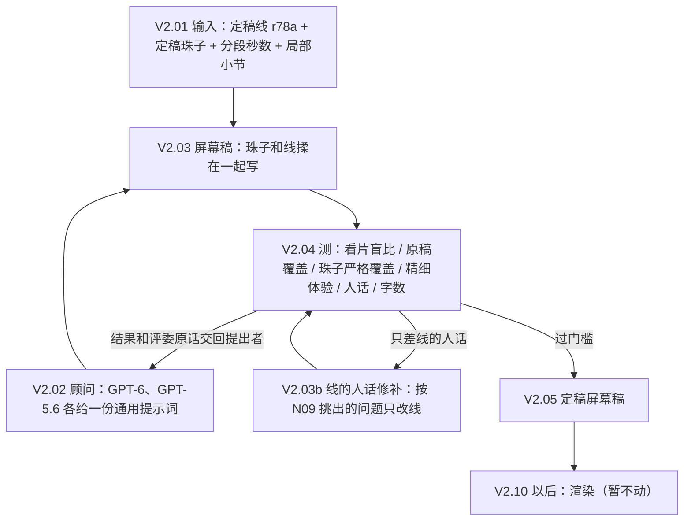

# DAG2：从定稿（线 + 珠子）到大众版视频

地位：视频这一段的现行流程。线和珠子怎么来，看 `_thread_evo_20261019/DAG.md`；DAG2 从那里的定稿接手。要做到什么，看 `_video_public_20261104/大众版标准.md`；用户原话看同目录的 `用户判定.md`。流程、提示词、模型、节点有任何改动，先改这里。

11-04 的 V1/V2（r54weave 全文上屏、节点加连线、三档右栏）已被用户否定，移到 `DAG2_历史_V1V2.md`，只作历史。

代码在 `D:\musicclaude\_video_public_20261104`（下表的脚本都在那里），提示词归档在本目录 `prompts/`。

**现在只做内容段（V2.01–V2.05），渲染段（V2.10 以后）暂不动。** 用户 11-06：“目前应该都还没有到画面的时候吧……我们就现在停留在渲染前面 这都还是内容部分吧？”



## 内容段

| 节点 | 做什么 | 脚本 | 模型 | 提示词 |
|---|---|---|---|---|
| V2.01 输入 | 定稿线（r78a）、定稿珠子全文（带编号、角色、小节、是否局部）、每段秒数；把珠子按句拆成要点，供覆盖评审逐条判 | `pub2.py prepare`（新作品用 `op52_up.py src`）→ `r2/{作品}_src.json` | 无 | — |
| V2.02 顾问 | 两位顾问读标准、用户原话、测量结果，给写手一份通用提示词；之后每轮把结果和评委原话交回提出者，由他改提示词 | `pub24.py adv` / `revise*` | GPT-6、GPT-5.6（不用 Argon 当顾问，用户 11-05） | `prompts/V2.03_屏幕稿_顾问/` |
| V2.03 屏幕稿 | 写手直接读完整珠子和定稿线，一次写出一份上下交替的屏幕稿：线一行（标出要放大的关键词、一种情绪色），感受一行（碎片，每块注明来自哪颗珠子，只属于某几小节的写 bars）。两首同跑、同一份提示词 | `pub24.py write 候选` → `r3/s24/screen_{作品}_{候选}.json` | GPT-6（gpt3、gpt4 两个账号分流） | `prompts/V2.03_屏幕稿_写手/prompt_*.txt` |
| V2.03b 线的人话修补 | 只差“线的人话”时用：把 N09 评审对线挑出的单句问题和累积问题交给写手，只改被点到的线和累积问题的证据句；意思、关键词不变，不变长；感受碎片一字不动 | `pub24.py fixlines 来源 新` | GPT-6 | 提示词在 `pub24.FIXLINES` |
| V2.04 测 | 见下节 | `pub24.py test 候选` | GPT-6、GPT-5.6 两位评委 | `prompts/V2.04_*` |
| V2.05 定稿 | 两首一起过门槛的候选成为屏幕稿主线 | — | — | — |

脚本只做机械的事：替换占位符、核对感受的来源珠子编号、核对 bars 落在原珠子写明的范围内（不在就去掉）、只保留线里真有的关键词、统计字数。内容全部由模型写，没有人工挑选或改字。

### 屏幕稿的格式

```json
{"plan":"全曲怎么排、哪些词前后呼应",
 "sections":[{"sec":"S01","rows":[
   {"kind":"line","text":"线这一行","keys":["放大的关键词"],"emotion":"炽热|欢喜|亲密|安心|孤单|不安|悬着","from":["S01-1"]},
   {"kind":"feel","items":[{"text":"一个碎片","bead":"S01-B2","bars":"12–14 或空"}]}]}]}
```

rows 从上到下排。情绪七选一，同一条线下面的感受跟它同色。

### V2.04 测什么（都是两首 × 两位评委）

| 测法 | 问的是什么 | 现在的视频 w23 | 脚本 |
|---|---|---|---|
| 看片盲比 | 扮边听边扫的观众，正反 8 票比新稿和现在的视频：扫得动、抓得到要点、知道为什么、前后是一件事、感受细 | — | `pub24.vs_one` |
| 原稿覆盖 | 原稿（珠子要点 + 线）每条在屏幕上留住 / 部分 / 没有，线和感受都算 | 留住 70–76% | `pub_cover.py` |
| 珠子严格覆盖 | 只看屏幕上的感受，原稿珠子里那个具体的画面、身体感觉、比喻、心里话、转折还在才算留住 | 留住 45–86%（平均约 63%） | `pub24.bead_cov` |
| 精细体验 | 评委从原稿每段挑最精细、换个说法就没了的地方，看屏幕上还在、变粗还是没了 | 还在 12–17（每首每位约 40 处） | `pub21.py` |
| 人话 | 线那边的 N09 开放评审，读两遍：只读线、读整屏；加句式统计 | 定稿线 7.5–8 分 | `pub18.lang_one`、`pub24.lang_all`、`pub18.meter` |
| 字数 | 全屏字数和现在的视频之比；线多少行、平均多长；感受多少块 | 1.0 | `pub24.py stats` |

送测前先过机械预检 `pub24.py precheck 候选`：感受是碎片（平均不超过 8 字、几乎不带逗号句号）、每条线有情绪色、总量不超过现在的 1.4 倍；不过就不送测。第九轮顾问整份重写后又写回整句、总量到 2 倍，所以加了这一步。

汇总：`pub24.py gate 候选` 按下面的门槛逐首对照现在的视频，两位评委取平均。

### 门槛（暂定，都和现在的视频比，两首一起过才算）

- 看片盲比 8 票里至少 6 票选新。
- 原稿覆盖、珠子严格覆盖、精细体验都不低于现在的视频。
- 人话：线不低于定稿的线；整屏没有比现在多出新的中等以上累积问题。
- 感受是碎片（用户 11-06：“看起来完全不碎啊？还是句子？？”）。
- 注意力要经济：字数没有硬上限，但多出来的字只能给小字的感受，线要比现在短。

### 当前的屏幕稿主线（11-06）

g68L2，线是 r78a：用第八轮 GPT-6 的写手提示词（`prompts/V2.03_屏幕稿_写手/prompt_g68.txt`）两首同写，再按 N09 意见修两轮线的人话。两首一起过全部门槛：看片盲比 3/4、4/4；原稿覆盖 0.89、0.98（现在的视频 0.79、0.77）；珠子严格覆盖 0.93、0.98（0.55、0.72）；精细体验 0.45、0.73（0.30、0.40）；线的人话 7.75、8.0（定稿 7.75、7.75）。字数 1.1 倍，感受是一首 410–430 个碎片。产物：`_video_public_20261104/r3/s24/screen_{作品}_g68L2.json`。

**11-06 线换成 r79d 后重跑（`line_r79d/`），四版都没过，主线仍是上面的 g68L2（r78a）：**

| 版本 | 看片盲比 | 原稿覆盖 | 珠子严格 | 精细 | 线人话（定稿 7.75 / 8.0） | 没过的项 |
|---|---|---|---|---|---|---|
| g68（直接写） | 4/4、3/4 | 0.93、0.92 | 0.97、0.97 | 0.54、0.67 | 7.25、7.0 | 线人话 |
| g68L（修一轮线） | 2/4、2/4 | 0.93、0.91 | 0.96、0.96 | 0.79、0.65 | 7.75、7.25 | 盲比，op61 线人话、累积问题 |
| g68L2（修两轮） | 2/4、3/4 | 0.90、0.92 | 0.97、0.96 | 0.73、0.62 | 8.0、7.5 | op60 盲比、累积问题；op61 线人话 |
| g68S（严格修线，不许变长） | 4/4、2/4 | 0.91、0.90 | 0.97、0.97 | 0.66、0.62 | 7.5、7.25 | op60 线人话；op61 盲比、线人话、累积问题 |

现在的视频（w23）对 r79d 原稿：原稿覆盖 0.77、0.68，珠子严格 0.59、0.68，精细 0.37、0.27。覆盖三项每版都远高于 w23，卡在“线的人话”和“看片盲比”此消彼长：修线后人话上来，盲比就掉；每首只有 4 票，噪声大。r79d 的定稿线人话本身更高（op61 8.0），屏幕上的短线更难追平。严格修线的开关是 `PUB_FL_STRICT=1`，只在 `line_r79d/pub24.py` 里有；它没解决问题，所以没并回主脚本。候选 g68 导出在 `deliver_20261106/基于r79d_未过门槛/`。

### 线换了版本怎么跑

`bash _video_public_20261104/dag2_newline.sh 线TAG prep`，再 `bash dag2_newline.sh 线TAG run`。
- prep：在 `line_<TAG>/` 建工作副本，用新线的合写稿（`v6weave.py`）生成输入，不调模型。
- run：先把现在的视频按新原稿重测一遍基线，再用 g68 提示词写、修两轮线、每步全套测试，最后对照门槛。
- 所有模型调用编号都加后缀 `_L<TAG>`，不会命中旧线的缓存。

## 渲染段（暂不动）

| 节点 | 做什么 | 脚本 |
|---|---|---|
| V2.10 音乐数据 | 已对齐的 MIDI、小节表、录音 → 音符数据，校正起音 | `prep_music.py`、`align_music.py` |
| V2.11 明确指向 | 只有词本身指向某个声音时才给音上色 | `pub18.py explicit` |
| V2.12 画面 | 上下交替、关键词放大、情绪色；局部小节的感受到时出现（和“明确指向才上色”分开） | `film_v8.py`（试验） |

## 修订记录

- **2026-11-06：** 重写。旧 V1/V2 移入历史。内容段从“先拆词、再按匹配配线”（w23，`pub11/14/17/19`）改为屏幕稿节点：珠子和线揉在一起写，上下交替。依据是用户 11-05、11-06 的原话，以及 `_video_public_20261104/线的视频形态_1105.md` 里的八轮试验。新加两个测法：珠子严格覆盖、整屏人话。
- **2026-11-06（晚）：** 线换成 r79d 重跑，四版都没过门槛（见“当前的屏幕稿主线”下的表）。主线仍是 g68L2（r78a）。下一步要解决的是：屏幕短线的人话和看片盲比此消彼长。
