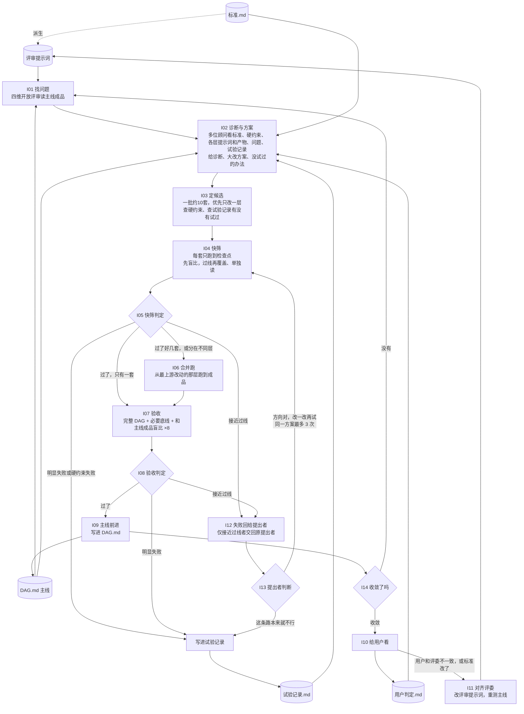

# 迭代准则：怎么一步步把 DAG 改到标准要的样子

地位：仅次于 `标准.md`。`标准.md` 定线要做到什么，`DAG.md` 是现在怎么生产，这份定怎么改 DAG。标准 + 基线 + 这套准则，就应当一步步逼近想要的成品。
改这份文件需要用户同意，并在文末修订记录里记一笔。节点编号用 **I**，和 DAG 的 N 区分。

**怎么用这份准则**：下面的节点是一块块可以组合的做法，尽量照着走，但不死板。实际执行时（我或 Codex）按情况灵活选用、跳过或增加块；出了问题当场修，不等流程走完。不变的只有两样：标准，以及第二节的硬约束。

## 一、文件与职责

每个文件只管一件事，只有一个地方写它。像齿轮一样：每个节点读哪些文件、写哪个文件都是固定的（见第四节）。

| 文件 | 管什么 | 谁写（唯一） | 谁读 |
|---|---|---|---|
| `标准.md` | 线要做到什么：四个维度、形态 | 用户 | 评审提示词的来源；顾问 |
| `迭代准则.md` | 怎么改 DAG：文件职责、迭代范围和硬约束、流程、判定线、规则 | 用户同意后改 | 我；硬约束一节给顾问 |
| `DAG.md` | 现行主线：节点、提示词、模型；修订记录只记**收下**的改动 | I09 | 顾问（读各层提示词）；运行脚本 |
| `试验记录.md` | 每个试过的方案：假设、改了什么、结果、原因、结论（含以前所有“别再试”） | I05、I08、I13 | 顾问；I03 定候选时查重 |
| `用户判定.md` | 用户对成品的评判原话 | I10 | I11 校准评委；顾问 |
| 评审提示词（代码里，`python exp_export.py` 导出到 `迭代准则_评审提示词.md`） | 怎么测四个维度 | I11 | 各测量脚本 |
| `STATUS.md` | 现在在哪：主线版本、在跑的候选、最近结果、待用户过目的事 | 每一步覆盖更新 | 接续或压缩后先读它 |
| `VERSIONS.md` | 每个版本的来历和测量 | `python versions.py` 生成 | 查数 |

存档、不再更新、不喂给模型：`THREAD_SPEC.md`、`标准_材料/`、`开发规范.md`（已并入本文）。

## 二、迭代范围和硬约束

**不在迭代范围**（已定，DAG 里照常运行，迭代不改）：分段 N01、A 稿 N02、珠子 N03、Center N04。
**迭代的对象**：从 Center 和分段出发、产出线的那一段 DAG，以及线和珠子怎样排在一起。

**任何方案都必须满足**（顾问提方案、I03 定候选、I13 改版时都要逐条查）：
1. **泛化**：换任何作品、任何作曲家都能照样跑。提示词、评审、规则里不放具体作品的例子，也不写只针对眼前某处毛病的规定。检验办法：换一首完全不同的曲子，这句话还说得通吗？说不通就不能加。（最容易返工的地方。）
2. 成品全部由流水线产出，不经人手修改。
3. 构思经历（写稿）时不看珠子；珠子最早在综合写线时进来，要不要进来看效果。
4. 珠子的内容不改；结合时线和珠子的内容都不改。
5. 允许联网。
6. 两首作品同跑、同一套提示词。

## 三、流程

## 四、节点

| 节点 | 做什么 | 读 | 写 |
|---|---|---|---|
| I01 找问题 | 四维开放评审读主线成品，按四个维度找问题，不打分（`e2e_open.py`；GPT-6 ×2、5.6 ×2、Gemini 3.8） | 主线成品、评审提示词 | 问题清单 |
| I02 诊断与方案 | 顾问（`prompt_advisor.py`；GPT-6 ×2、5.6、Gemini 3.8、Argon）回答：哪层哪句造成哪个问题；1–2 套大改方案（可删层、并层、改顺序、整层重写，写出完整提示词）；没试过的办法；风险 | `标准.md`、本文第二节、`DAG.md` 各层提示词和产物、I01 问题、`试验记录.md`、`用户判定.md` | 顾问意见 |
| I03 定候选 | 一批约10套，多位顾问各提独立假设，优先只改一层；逐条查硬约束和历史，不为凑数收同义版本 | 顾问意见、`试验记录.md` | `STATUS.md`（候选名和假设） |
| I04 快筛 | 每套只跑到检查点，两首同跑、多套并行；先盲比，不可能过线即停；过线再补覆盖、单独读 | 候选方案 | 检查点产物和测量 |
| I05 快筛判定 | 脚本按判定线算过没过 | 测量结果 | `试验记录.md`（结果） |
| I06 合并跑 | 几套都过了、分在不同层或担心冲突时，合在一起从最上游改动的那层跑到成品 | 过了的方案 | 合并版成品 |
| I07 验收 | 完整 DAG，复用合格快筛结果，补到8份盲比及必要底线；诊断按需 | 候选成品 | 测量 |
| I08 验收判定 | 脚本按判定线算过没过 | 测量 | `试验记录.md`（结果） |
| I12 失败回给提出者 | 仅对接近过线者退回全部已完成理由和原方案，不为凑反馈补买缺失诊断；其余归档换方向 | 测量、原方案 | — |
| I13 提出者判断 | 提出者判断：这条路本来就不行（写明为什么），还是方向对、某处没做好（给出改过的提示词，回 I04） | 原因清单 | `试验记录.md`（结论） |
| I09 主线前进 | 改动写进 `DAG.md`（节点、提示词、修订记录），跑 `dag_export.py` | 收下的方案 | `DAG.md` |
| I14 收敛了吗 | 收敛 = 连续两轮没有新方案通过验收，且四维开放评审不再挑出“中等”以上的新问题。没收敛就回 I01，不叫用户 | `试验记录.md`、I01 结果 | `STATUS.md` |
| I10 给用户看 | 交带版本名的成品（只看线、和珠子排在一起各一份），不交中间产物 | 主线成品 | `用户判定.md`（用户原话） |
| I11 对齐评委 | 用户和评委不一致、或 `标准.md` 改了时，改评审提示词，使它能抓出用户指出过的问题、复现用户的判断；改完在同一路由下重测主线 | `标准.md`、`用户判定.md` | 评审提示词 |

## 五、检查点和判定线

**检查点**：改动所在层之后、第一个能拿来测的线产物；跨好几层的方案，就在新流程出线的地方。候选和主线在同一位置比。（已验证：mb 在提覆盖后的检查点盲比 0/4，跑完全程 0/8，结论一致。）

**测量**：覆盖 `v6cov`（逐颗珠子）、单独读 `v6alone`（只读线）、盲比 `v6fix blind`（两版逐段比四个维度）、四维开放评审 `e2e_open`（只找问题）。

**判定线**
- 底线：覆盖任何一段两位评委都掉 2 分以上，或单独读少成立一段，就不过。
- 快筛：盲比 4 份里至少 3 份选新版；单独成立、啰嗦、人话的净胜都不为负。
- 验收：盲比 8 份里至少 6 份选新版；单独成立、啰嗦、人话的净胜都不为负；至少 6 份判“不算退步”。
- 净胜 = 每份里“新版赢的段数 − 旧版赢的段数”，取平均。开放评审的分数不作判定。

### 分关执行（2026-11-02 用户授权修订）

新入口 `experiment_batch.py`，单版本和旧测量入口转交 `screen_flow.py`。标准、硬约束及上面的通过门槛不变。

1. **批量**：默认三位顾问各给4/3/3套A4方案，共约10套，共用材料；优先固定A1/A2/A3。需要改上游时另组批次，逐套查泛化、接口和独立假设，不凑同义版本。
2. **复用**：实际输入逐字相同、同模型/High/通路且已完整返回才复用原文，记来源和输入/输出哈希；上游改变重新渲染下游，不按文件名猜测。新产物全文读、查硬约束后才继续，由执行者检查，不增加付费审稿层。
3. **先盲比**：每完成一票计算剩余票/净胜最好上界，若不可能达到3/4或必需维度净胜非负即确定淘汰；缺票不记0。四份完整过线才补底线。
4. **再底线**：先双曲双评委覆盖4次，不过即停，再单独读4次。单独读不捆绑复述诊断。主线缺失底线按批共享，只补一次。
5. **验收和诊断**：幸存者完成所需生产、补到8份盲比并核对底线，原6/8、净胜和不退步门槛不变。开放评审用于I01/I14或必要诊断，复述珠子按需，不对每个失败版本默认全买；缺测标缺测。
6. **交叉定位**：多层失败且有保留价值时，先做上游(A1/A2)×A4；若指向上游，可用 `--split-upstream` 独立交叉A1、A2。先查中间语义/接口兼容，复用不变步骤、另起版本，不拼接或手改正文。一次交叉仅提供定位证据，不声称精确定量因果。
7. **仅接近过线退回**：四票完整、至少2票选新，仅差一个条件才考虑退回：少1张整体票，或一个必需维度平均净胜至多低1段，或一个已测底线失败位置；其余归档换方向。最多尝试3次，硬约束失败直接归档；未完成和基础设施错误不是接近过线。这只决定是否花下一轮调用，不改变通过门槛。
8. **并发**：一批10套与同时在途分开。默认4个工作任务，全局仍不超过10、提交间隔20秒；沿用现有保护/普通故障分类，不绕过资源故障。

| 两首作品的明显失败方案 | 生成 | 盲比 | 合计 |
|---|---:|---:|---:|
| 四步从头生成 | 8 | 2–4 | 10–12 |
| A3实际输入一致可复用 | 6 | 2–4 | 8–10 |
| 只改A4，前三步可复用 | 2 | 2–4 | 4–6 |

幸存者还需最多8次底线、4次追加盲比；主线缺失底线最多8次按批共享；顾问调用另计。十套是否40分钟出结果受通路、回答时长、失败率影响，不作承诺。旧四步若全买4盲比、4覆盖、4单独读、4复述、10开放评审，共34次；只换A4是28次，36/30不是所有方案的固定数。

## 六、给人看的进度表

每轮结束更新 `进度表.md`（`python scoreboard.py` 生成），只给人看，不作判定：
- 每个版本一行：字数、覆盖（两位评委）、单独读成立段数、四维开放评审挑出的中等以上问题数（按维度）、和主线盲比的结果（选新版几份、各维度净胜）。
- 中途审阅只看一条链：最新版对基准版的“提示词改动 → 前后差别 → 文件原文”。写在 `版本说明/<tag>_vs_<base>.md`，`scoreboard.py` 会把它并入例子节。
- 回复里不再另写汇报，也不重抄表里的分数和例子；用户只看这条链，其余留在文件里。

## 七、规则

1. 标准和判定线只有用户能改；迭代的手段可以变，标准不变。例外（11-08 用户同意）：DAG 的定稿只作 DAG2 的原料，DAG 的 `标准.md` 是手段，可以由我修改，但只能凭端到端证据（两份只差这一点的 DAG 定稿各走同一条 DAG2，按大众版标准比成品，两首都有差别），每次改动记下证据并在关键节点报给用户。大众版标准（DAG2）是目标，只有用户能改。
2. 只有一条主线，成品只从主线出；不另起一条“看着更好”的线去修补。
3. 找改法要大胆（可以删层、并层、整层重写），判定要严（只比同一位置）。
4. 平时只快筛；只有合并跑和验收才跑完整 DAG。
5. 接近过线才退回原提出者，最多尝试3次；明显失败或硬约束失败记原因并换方向，不串行耗尽三次。基础设施失败不算质量失败或一次修改。
6. 自己跑到收敛再叫用户；中间不等用户决定，只有违反硬约束的取舍、账号问题才问。
7. 以用户为准：评委和用户不一致就对齐评委，不是说服用户。
8. 跑之前核对输入（打印读进提示词的条数，0 条就停）；第一个产物出来就读，不对立刻停。
9. 只报测到的；没测完就说做了一半，不交付。只在失败、完成、结论时通知用户。
10. 多套并行；只等完成通知，不守着；MimicGate 总并发不超过 10（`MG_GLOBAL`）；遇到保护信号停下、告诉用户。
11. 不用 git、不开 worktree：并行靠各自的版本名；交给 Codex 的活写清只动哪些文件；旧提示词在 `runs/<编号>/prompt.txt`。

## 修订记录

- **11-02**：建立。起因：一次实验从提覆盖往下跑 15 步、3 小时，只为验证一个小改动；每次只改一句，找不到真正把文字带偏的东西。用户要求：检查点快筛、只在合并或验收时跑全流程；多位顾问看提示词给大改方案；评审提示词列出来过目；像 DAG 一样有图，只写不变的规则。
- **11-02**：加 I12–I14（用户：没过的方案要给出原因交还提出者，判断放弃还是改了再试；自己跑到收敛再叫用户）。
- **11-02**：硬约束第 3 条按用户 10-23 原话改回（“写稿的时候还是不看珠子……后面综合的时候……才会去（有可能 如果效果不好也不采用）看珠子”），之前写得太窄。
- **11-02**：加“怎么用这份准则”（各块灵活组合，出问题当场修）和“给人看的进度表”（用户：需要一些评分和简短例子直观看出好了多少）。
- **11-02**：加“文件与职责”和“迭代范围和硬约束”两节（用户：核心文件和职责要想清楚，能像齿轮一样卡住自己跑）。失败方案改记 `试验记录.md`，`DAG.md` 修订记录只记收下的改动；`开发规范.md` 并入本文；流水线约束从标准移到这里；判定线加上“单独成立”净胜（盲比提示词待 I11 对齐后生效）。

- **11-02，用户授权流程提速**：更新为分关测量、一批约10套、精确复用、交叉定位、仅接近过线退回。标准、六条硬约束和通过门槛不变；时间以实际运行验证。
- **11-04，用户要求查流程并修（“你看看能不能修一下”“你可以自己看看流程有没有问题”）**：标准、硬约束、4 票和 8 票门槛、评审提示词都不变，改的是产生候选和停止的办法，见下面“成品修补回路”。

## 成品修补回路（11-04）

起因：r54weave 按规则“收敛”，但直接比 r49b 只有 5/8 选新、4/8 不退步，Op.61 还退了；同时一个四项净胜大赢的候选（r55restored）因为只差不退步票被归档。

1. **默认候选来源**：只在当前主线上局部改，用 `round65_fix.py`。`repair` 按开放评审改，`restore` 把评委说丢掉的带回来。整篇重写多次输人话，只有要改上游时才用。“禁止重提”只禁重复已失败的提示词方案，不禁局部修订。
2. **验收阶段也能退回**：8 票里至少 6 票选新、三项净胜不为负、底线通过，只差不退步票时，把退步理由交回做 `restore`，最多 3 次。不再直接归档。
3. **守护清单**：评委说过“删了算退步”的内容，下一轮 `repair` 用 `--guard` 带上，不许再删。否则开放评审和盲比会把同一句话来回删补。
4. **两首同跑、一起过才算（用户 11-04 纠正：“只有两边一起通过才能叫更新成新主线啊 我们必须是一个泛化结果吧”）**：每一步都对两首走同样的提示词和同样的步骤，不许只对一首回补，不许把两个版本的两首拼起来。一个版本两首一起过 8 票才能前进。盲比和净胜也按作品分开报，但只用来诊断，一首过、一首没过就是没过。
5. **主线前进时查回退**：除了比当前主线，还要比固定锚点（11-06 晚起为 r79d：新盲比加入贴 Center、往前走之前的最后一条主线；用户：“怎么还在r49b啊 可以往前一点了吧”。之后每过几步主线、确认没有慢慢漂移，就把锚点往前挪）。比锚点没过，不算真进步。
6. **留出评委**：Gemini 不进盲比票和修补输入，只在主线前进时比一次锚点，查有没有迎合 GPT 评委。
7. **收敛（代替 I14）**：连续两轮、每轮至少两份独立候选，都没有任何一首过线。“没有新问题”不再算依据，开放评审一定还能挑出问题；还剩的中等问题照实列出，不说成解决。（11-08 晚起作废，由末节“收敛看成品”代替。）
8. **写稿和改稿走 MimicGate High，评审走 gpt3**：语气差异见试验记录（r65a 对 r65b/r65c）。这一条与“gpt3 优先”不同，待用户确认。

## 11-06 修订：推进和 Center 关联

- 用户：“我们目前像dfs而不是像迷宫back-and-forth这个我们现在还在优化吗……和center的关联性 这个可能也需要作为一个指标”。新加两个测法（DAG.md 的 N10p、N10c），都用两两对比。绝对打分（1–10）校准后没有区分力，不用。
- 推进已校准，可以当门槛：人为回摆版被认出 7/7。Center 对比的方向和预期一致（旧 Center 时代的 h23 输给 r78a），但票数还少，先作诊断，不作硬门槛。
- 修补时删条目会输：r79a、r79c 删掉“来回摆”的句子，单独成立和人话都大跌（0/8、5/8）。只改不删、改后不变长的 r79d 过了。修来回摆的办法是让后来那段带出新东西，不是删掉。
- 发现 N05a 骨架写着 Center“不是每一段都要回应的题目”，N05b 选路不看 Center 贴合。Q16 改了这两处，首稿更贴 Center，但其余维度全输，留待以后再试。
- 11-06 晚，用户：“要的呀 center 和来回摆都应该加入盲比”。正式盲比改为六项：单独、不啰嗦、人话、覆盖、贴 Center、往前走。门槛是 8 票至少 6 票选新、至少 6 票不退步，单独、不啰嗦、人话、贴 Center、往前走五项净胜都不为负；覆盖照旧只看不卡。调用编号前缀 v6b4，结果写到 `fair3_*.json`；旧版用 FAIR_V=2 复现。
- 11-06 晚，用户：“我在猜想 dag 的人话标准如果实在会冲突可能能放宽 反正 dag2 还要再人话化一遍”。新盲比里人话一项只看不卡（和覆盖一样），线这边不再为人话挡住往 Center、往前走的改动；人话由 DAG2 的屏幕稿负责。
- 11-06 晚：主线换成 r79l（新盲比下对 r79d 8/8、六项净胜全正）。修补意见要按每次比较标读者，否则 REPAIR 的“至少两位读者”规则会挡掉所有改动。
- 11-06 晚（续）：r79l → r79n → r79o（回补评委说丢的内容）。盲比门槛：一首没改时不计这一首的票，按比例算。
- 11-06 晚：盲比门槛按每首分别算（用户 11-04：合计不能盖住单首失败）：每首改动了的作品，选新、不退步各至少四分之三，单独、不啰嗦、贴 Center、往前走净胜都不为负。r79o 按这个算对 r79l、r79d 都过。

## 11-07 修订：评委矫正机制
- 用户原话：“你认为他目前评委有问题的时候 可以再给一个新的agent问问他 是不是这个提示词问题 然后怎么修 这样就可以印证你的 就是目前的评委显然就是能够作为补充你想不到的东西 但是他出问题的时候我们必须要有矫正机制”。
- 做法（`_video_public_20261104/judge_check.py`）：怀疑某个评委量得不准（同一版两次测差得比两版之间还大、和其他评委或看片盲比冲突、扣分的地方明显是设计如此），就把评委提示词、输出样本、症状和证据写成 `judge_check/CASE.md`，交给两位顾问（GPT-6、GPT-5.6）各自独立查：
  - A 轮不给我的结论：是提示词问题，还是评委其实对、我的预期错了？根因？怎么改？怎么验证？
  - B 轮给出我的诊断和改法：对不对、漏了什么、会不会带来新偏差？
- 两位顾问 A 轮独立指向同一根因才算印证；有分歧就照意见再改，仍有分歧就报给用户。评委本来是用来补我想不到的东西的，所以不能因为结果不合我意就改评委，要先过这一关。
- 改过的评委要做两项验证：同一版测两次是否接近；和已知结论对照。
- 首批：精细体验（旧法每次现挑句子，改成固定清单）、整屏累积问题（同簇近义不算堆叠）。

## 11-08 修订：DAG2 也照此执行
- 用户原话：“迭代准则可以改啊，你就加这一个小节”。起因：11-08 做 DAG2 时没按这份准则走（本准则原来只管写线的 DAG），自己直接写提示词，结果写稿提示词和评委提示词里都放了船歌原文当例子，违反硬约束 1；事后查出 11-07 从定稿线重写屏幕线的提示词（`relines.py`）也有船歌原文。
- 从现在起 DAG2（把定稿的线和珠子做成大众版视频，`_dag2_video_20261104/DAG2.md`）照这份准则执行：流程（I01–I14：多位顾问诊断出大改方案、一批候选并行快筛、接近过线交回提出者、主线只有一条）、第二节的硬约束、第七节的规则、评委矫正机制，全部适用。对应关系：标准换成大众版标准（继承 DAG `标准.md` 的四个维度，再加 DAG2 自己的扫读、揉在一起、对定稿的覆盖），主线文件换成 `DAG2.md`，成品是屏幕稿和视频。
- 硬约束 1（泛化）加机械检查：每个提示词模板发出前先过 `_video_public_20261104/line_r79o/prompt_lint.py`，模板里出现两首作品原文的片段就报错、不发出。新写的写稿和评委脚本都要接上。
- 新评委（新测法）先校准再当门槛：用已知有差别的版本或人为造的正反对照，分得开、同一版测两次接近，才能卡；校准用的提示词里不能带答案（不放被测版本的原句当例子）。

## 11-08 修订：绝对分数项的测量误差（测法，判定线不变）
- 起因：K3M2 只比 K3A 删了小节号，船歌整屏珠子覆盖 0.666 对 w23 0.67、整屏人话 7.083 对 7.167，按单次平均数比大小判没过。同内容换调用编号重测（`r3/noise.py`）：4 位评委平均，覆盖两次差 0.01–0.06，人话差 0–0.25；人话只有 7、7.5、8 三档，一位评委改半档就差 0.08–0.125。按评委矫正机制问了两位顾问（`judge_check/noise_*`），两位独立认为：差距小于测量本身的波动，不能当失败；但“复测后灰区减半”“灰区外直接判失败”没有依据。
- 判定线不变（仍是“不低于 w23”），只改怎么测、怎么下结论（适用：整屏珠子覆盖、原稿覆盖、精细、整屏人话）：
  1. 候选平均高于等于 w23：过（同前）。
  2. 低于 w23、但差距在灰区内（暂定覆盖 0.03、人话 0.25，等校准后再定）：候选和 w23 在同一批里各重测一次（换调用编号、评委席位一样），两轮合起来按席位算配对差值（候选减 w23），GPT-6、GPT-5.6 两家分开报、等权合并。合并差值不为负：过；为负：记“待复核”。
  3. 低于 w23 超过灰区：没过。
  4. 同一版本同一项最多复测一次，所有调用结果都留着，不许挑有利的那次、不许删了重补。“待复核”不算过，主线不能凭它前进；可以继续当比较对象，并在关键节点照实报给用户。
  5. 只改格式、不碰内容的版本（例如只删小节号），另外和改动前的版本做配对比较，看这几项是否等效（差值在灰区内、两家方向不矛盾）。
  6. 每批正式评测时 w23 也同批测；换了评委提示词或模型，w23 必须重测，不用旧数。
  7. 灰区校准：同内容版本多测几轮（每轮 4 个席位都齐），按作品分开估计；校准前灰区只用来决定要不要复测，不单独作为淘汰依据。
- 提速（11-08 用户同意两位顾问的提速建议：“可以 都可以”）：分阶段快筛（`r3/stage.py`：先盲比 2 位评委，明显输就淘汰，再走样和覆盖 2 位，再补齐 4 位）；每个账号在途 8（试验）；整屏珠子覆盖可以按段切 3 份并行测（`PUB_BC_SPLIT=3`，存为 `beadcovAP3_*`，与整首测法分开存档，校准一致后再换），同一评委、同一段文字一字不差就沿用以前的结果（`bc_cache`，测量误差复测时用 `PUB_BC_NOCACHE=1` 关掉）。
- 首例结论：K3M2 对 w23 两轮配对差值，船歌覆盖 +0.021（过）、人话 −0.188（GPT-6 −0.25、GPT-5.6 −0.125，两家同向）→ 待复核；幻想全部过。K3M2 对 K3A（只差小节号）船歌覆盖 +0.019、人话 −0.125，在灰区内。K3M2 继续当比较对象（盲比对 K3A 6/6 稳定选 K3M2，且 K3A 不过“正文无小节号”硬检查），船歌人话记待复核。
- 分段覆盖测法校准结果（11-08 21 点前后，`r3/calib_split.log`）：单次调用平均 142 秒（整首测法 311 秒），确实更快；但和整首测法对不上——幻想 K3M2 分段测 0.732、整首两次 0.832/0.831，K3M2 比 w23 高出的量从 0.11 缩到 0.03；船歌反过来，K3M2 领先从 0.02 放大到 0.05。逐条看，差异分散在各段，多是“留住→部分”。可能的原因：揉在一起的稿子会把某颗珠子的内容写到相邻段，整首测法能看到，分段测法看不到。结论：分段测法不换上，门槛和快筛仍用整首测法（`PUB_BC_SPLIT` 默认 1）；增量沿用（`bc_cache`）跟着分段测法，暂时也不用。

## 11-08 晚修订：收敛看成品
- 用户原话：“你是说目前的标准真的有冲突吗 不能一起满足？”“对啊 所以你现在的收敛标准有问题呀 你实际做出一个剩余的问题都是很微小的再给我看”。
- 起因：我按第七节“连续两轮、每轮至少两个独立候选都没过线”宣布收敛，还说卡在标准冲突上。对照标准原文，不冲突（第 3 条一种感受一个说法；第 6 条只问留下的够不够具体；第 5 条只要求核心不丢、先排主次），是测法比标准严或量偏了：覆盖门槛 150 多条要点一样重；盲比的“细腻”可能在数细节多少。
- 改为：收敛 = 实际做出一版，开放评审（两首、两位评委）剩下的问题都只是轻微的。“两轮没过线”只说明这条路走不通，要换路或查测法，不能当收敛。候选一直过不了时，先对照标准原文查测法（评委矫正机制），不把测法造成的冲突说成标准冲突交给用户。
- 11-08 晚 新测法（两位顾问问诊 `judge_check/coverfine_*` 后的共同方案）：
  - 新盲比 vs3（`PUB_VS3=1`，结果 `vs3_*`）：fine 只看留下的说法具体不具体、不看多少；concise 看信息是否重复、不看情绪类别；整体允许判平。校准三组都符合预期：同一版对同一版七项全平；人造“只加近义重复”对照（`r3/dup.py`）fine 0:0、concise 0:8；T2（具体细节换成“声音”）fine 0:8。启用。
  - 新覆盖 cov3（`units.py`）：原稿先拆成意思单元（GPT-6 拆，GPT-5.6 审），分 核心 / 重要 / 补充，替代说法并成一个单元。结果：两首都没有“只是换个比喻”的单元（原稿珠子几乎都带不同的东西），核心占一半多。校准：近义重复对照和 K3M2 一样（不奖励重复），删得狠的 K3NR 明显低；但 w23 船歌同内容两次核心 0.676 / 0.794，噪声大；和“两位都判核心的要点覆盖”（`core.py`）方向不一致（w23 对 K3M2 船歌，一个说低一个说高）。所以三种覆盖口径（全部要点、两位都判核心的要点、意思单元）一起看，哪一样明显变差都不算过；还没有单独卡死一个数。
  - 发现：w23 每首只有 2500–2700 字，核心覆盖不比 3700 字的 K3M2 差，说明“短”和“不丢”能同时做到，难点在挑得准。
