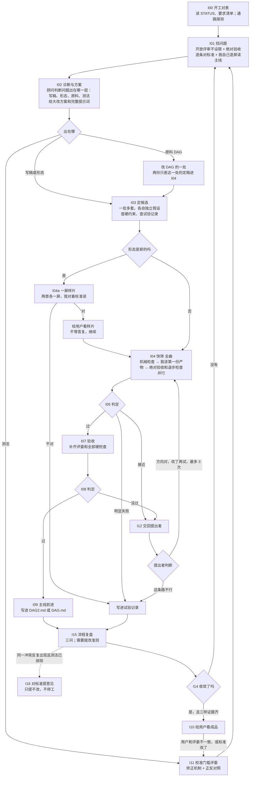

# 迭代准则：怎么把成品一步步改到标准要的样子

11-09 整理版。以前的图加六段补丁已并进正文；旧修订原文在 `迭代准则_修订历史.md`，整份旧版在 `迭代准则_备份_1109整理前.md`，两份都只是存档，和这里冲突时以这里为准。

**地位**：仅次于两份标准。标准定成品要做到什么，这份定怎么改流水线。
**谁能改**：我可以自己改这份准则（11-09 用户：“可能需要能够给他这个流程图自进化的权限”），但要照第八节的办法改；第八节列的三样东西不能动。
**压缩或接续之后**：先读 `STATUS.md`、`要求清单.md`、这份准则的第三节和第七节，再动手。

## 一、目标、两层和文件

成品只有一个：大众版视频（屏幕稿加渲染）。两层流水线：

| 层 | 做什么 | 标准 | 主线文件 | 怎么判断好坏 |
|---|---|---|---|---|
| DAG2 | 把定稿的线和珠子做成大众版屏幕稿和视频 | `_video_public_20261104/大众版标准.md`（只有用户能改） | `_dag2_video_20261104/DAG2.md` | 直接按大众版标准验收成品 |
| DAG | 新作品 → 珠子和线的定稿，只作 DAG2 的原料 | `_thread_evo_20261019/标准.md`（我可以凭端到端证据改） | `_thread_evo_20261019/DAG.md` | 只看端到端：两份只差这一处的定稿走同一条 DAG2，比成品 |

DAG 不单独宣布“收敛”。它的状态只写两样：现在用哪一版当原料；最近一次端到端证据是什么。

| 文件 | 管什么 | 谁写 |
|---|---|---|
| 两份标准 | 成品和原料要做到什么 | 大众版标准：用户。DAG 标准：我，凭端到端证据 |
| `迭代准则.md` | 怎么改流水线：流程、判定线、规则、怎么自己改自己 | 我，照第八节 |
| `DAG2.md`、`DAG.md` | 现行主线：节点、提示词、模型；修订记录只记收下的改动 | I09 |
| `试验记录.md`（两层各一份） | 每个试过的方案：假设、改了什么、结果、原因、结论 | I05、I08、I13 |
| `要求清单.md`（`_dag2_video_20261104/`） | 用户提过的每条要求：原话、做了没有、证据在哪 | 用户每提一条就记；每次汇报前对一遍 |
| `流程复盘.md`（`_dag2_video_20261104/`） | 每轮复盘的三问和流程改动的起因、预期、验证结果 | I15 |
| `用户判定.md` | 用户对成品的评判原话 | I10 |
| `STATUS.md`（两层各一份） | 现在在哪：主线版本、在跑什么、最近结果、等用户看的东西 | 每一步覆盖更新，不往后追加 |

## 二、硬约束（任何方案都要逐条查）

1. **泛化**：换任何作品、任何作曲家都能照样跑。提示词、评审、规则里不放具体作品的例子，也不写只针对眼前某处毛病的规定。每个提示词模板发出前过 `prompt_lint.py`，有作品原文就不发。
2. 成品全部由流水线产出，不经人手修改。
3. 构思经历（写线）时不看珠子；珠子最早在综合写线时进来。
4. 珠子的内容不改；DAG2 揉在一起时，意思不许走样（疑问写成断言、猜测写成确定都算）。
5. 允许联网。
6. **两首同跑、一起过**：每一步两首用同样的提示词、同样的步骤；一首过一首没过就是没过；不许拼版本。
7. 不在迭代范围：分段、A 稿、珠子、Center。

## 三、流程

## 四、节点

| 节点 | 做什么 |
|---|---|
| I00 开工对表 | 读 `STATUS.md` 和 `要求清单.md`；用一个最小请求探测通路；确认没有别的会话在改同一批文件 |
| I01 找问题 | 三个来源并列：开放评审（只找问题、不打分、不设限，它的用处就是补我想不到的）；绝对验收（门槛评委，按标准逐条判）；我自己对着标准逐屏读主线成品 |
| I02 诊断与方案 | 顾问只用 GPT-6、GPT-5.6，各自独立。回答：问题出在写稿、形态、原料（DAG）还是测法；一到两套大改方案（可删层、并层、整层重写，给完整提示词）；没试过的办法。读：标准、第二节、各层提示词和产物、I01 问题、试验记录、用户判定 |
| I03 定候选 | 一批多套（常规约 10 套，至少每位顾问各一套），各自是独立假设，优先只改一层。提示词由顾问出，我只查硬约束和查重；我自己想到的改法也交给顾问写成提示词，不自己直接写了就跑 |
| I04a 一屏样片 | 形态是新方向时先只写一屏（两首各一屏，挑内容最密的那屏）。我对着七条标准读；通过就把这一屏的两三个版本并排给用户看。不跑全曲测量 |
| I04 快筛 | 全曲。顺序固定：机械检查（免费）→ 我读第一份产物，不对立刻停并写明哪一条不对 → 绝对验收和退步检查并行（各 2 位评委）→ 意思走样、核心覆盖 |
| I05、I08 判定 | 照第五节判定线，脚本算 |
| I07 验收 | 补齐 4 位评委和全部硬检查；截图评委看渲染出的画面 |
| I09 主线前进 | 改动写进主线文件（节点、提示词、修订记录） |
| I12、I13 交回提出者 | 接近过线的，把全部理由和原方案交回提出它的顾问：这条路本来不行（写明为什么），还是方向对、某处没做好（给改过的提示词）。同一方案最多 3 次 |
| I14 收敛判定 | 见第五节 |
| I10 给用户看 | 见第六节 |
| I11 校准门槛评委 | 见第七节 |
| I15 流程复盘 | 见第八节 |
| I16 对标准提意见 | 见第八节 |

## 五、判定线

**两种评委，两种用法（11-09 定）**
- 开放评审：不卡人，不限制它说什么。每个候选都跑（`r3/open_free.py`，进快筛脚本），任何时候都不许停、不许用别的测法代替（11-09 到 11-11 停了两天，人话问题一路没人报）。它不给标准、不给检查单，不许改成照条打勾的评委；可以校准：照 11-01 效果好的那版（`_thread_evo_20261019/e2e_open.py`）的写法，用大白话告诉它这是什么、想做到什么、哪些不算缺点，并写明“上面没说到的问题，只要觉得不对也照样要说”；不列禁区（11-11 用户：“我说的校准是校准开放评委的提示词啊 比如说我们的目的什么的……我担心他现在不开放了”）。改完用同一版前后对照验证：被说明不算缺点的那一条不再当头号问题，其余大问题照样报得出来（11-11 用户：“开放评审是可以去校准的……但是不能关啊……也不能把他改成‘不是开放’的评委”）。
- 门槛评委：从标准派生，用来淘汰候选和宣布过线。它必须先校准（第七节），看到的必须是观众看到的东西（扫读相关的判断看截图，不看完整文字稿）。
- 逐条校准（11-10 晚补）：门槛评委覆盖的每一条标准都要有自己的反面对照（只坏这一条），分得开才算这一条能测；没校准的条目，它报“没问题”不作数，要由别的已校准测法（如盲比分项）兜底。防止评委只学会认一种坏法：每条用两三种不同的通用改法造对照（脚本或通用提示词，两首同一套，不针对具体屏）；另留一组用户判过的真实样本不参与调提示词，只用来验，对得上用户才算校准过。对照和样本只用来考评委，不进评委提示词、写手提示词和成品。起因：绝对验收第四版只用打转、分开、去音乐、笼统四个对照校准过，人话没有对照，大字不像人话一直测不出。
- 机械约束跟着标准走（11-10 晚补）：标准改了，写手的机械检查（字数、逗号、块数）要同时复查一遍是否还和新标准一致。起因：第 8 条改成只算大块后，“大块最多一个逗号、≤30 字”没放宽，逼写手把线的一句话劈成两条结论。

**候选过线（两首各自都要满足）**
1. 硬检查全过：泛化、正文无小节号、意思不走样、核心内容覆盖不低于现在的视频 w23（差距在测量波动内时同批配对重测，不拿单次平均数比大小）。
2. 绝对验收（按大众版标准逐条）：没有严重问题；中等问题比主线少，或者一样多但换成了更轻的。
3. 退步检查（和主线盲比，两种先后顺序都测）：没有“两位评委都稳定选旧”的情况。有的话看理由：
   - 理由对得上标准的某一条：算退步，走 I12 交回提出者。
   - 理由对不上标准，或者和标准相反：不淘汰，触发 I11 查评委。
   - 形态是新的候选，盲比总体输不直接淘汰，以第 2 条为准。
   - 逐项看（11-10 晚补）：总体之外，每个分项（人话、细腻、核心……）也单独看；某一项两首里有一首两位评委都输给主线，就算这一项退步，形态新也不豁免，交回提出者，并查有没有违背实验结论里已有的教训。起因：K25–K27 新形态盲比 human 一直 3:0–4:0 输 K11g，靠上一条豁免过线，人话一路掉，用户 11-10 晚判“不是正常人在说话”。

**收敛**
实际做出一版，绝对验收和开放评审（两首、两位评委）剩下的问题都只是轻微的。“几轮候选都没过”只说明这条路走不通，要换路或查测法，不算收敛。

宣布收敛或说“定稿”之前，三样证据要齐，缺一样就只能说“当前最好的一版，还差什么”：
1. 用到的门槛评委都有校准记录（正反对照分得开、同一版两次接近）。
2. 写明这一版相对上一次交付改了多少（新写了多少字、哪些屏变了）。
3. 我自己逐屏读过，读的结论和评委一致；不一致先走 I11。

**DAG 的改动**
只按端到端证据收下：两份只差这一处的定稿各走同一条 DAG2，按上面的线比成品，两首都有差别才算。DAG 层自己的测法（推进对比、贴 Center 对比、DAG 绝对验收）只作诊断。

## 六、什么时候找用户

只在这几种情况，其余自己往前做（账号保护自动切换、两个都保护就等 50 分钟重试，都不问）：

1. **新形态的一屏样片**（I04a）：一屏、两三个版本并排，两分钟能看完。
2. **宣布收敛之前**（I10）：带版本名的成品、测量结果、剩余问题、这版改了多少。
3. **我读的结论和校准过的评委相反**，两位顾问也没法定。
4. **标准没规定的事**（主要是画面怎么分区这类）。
5. **对标准的意见**（I16）。
6. 账号、硬约束取舍。

**判断要不要找用户，只看两点同时成立**：这件事靠标准和校准过的工具定不了；定错了后面会白干好几个小时。其余都自己定。

**自动绊线（防止在没用的东西上干很久，触发就发一行给用户，不停工）**
- 同一个方向连续两轮、或累计约 3 小时，最好版本的中等问题数没有减少：报“试了什么、为什么没用、下一步换什么”，并回到 I02 让顾问换方向。
  - 每小时检查时都要对这一条（这个方向已经几小时、最好版本的中等问题有没有减少），到点就停，不等这一批跑完（11-10：K25、K26 做了 8 小时多才停）
  - 两个指标此消彼长超过一次交回：先查这两个指标的测法和对应的标准条文（必要时按 I16 向用户提意见），再决定要不要继续改写法（11-10：覆盖把三分之二的单元算成核心、第 8 条把小字算进阅读量，换了三次写法才查）
  - 请顾问出方案每人至少三套、互为独立假设；每一批至少带一个只差原料的对照，DAG 不落下
- 连续两轮的候选相对主线几乎没有新写的内容（只是删和挪）。
- 我读的结论和评委相反。
- 通路连续零秒失败、或一小时没有任何调用完成。

找用户不等于停工：发出去以后继续做不依赖答复的部分；约半小时没有答复，就按自己的最好判断往下做，并标明“未经用户确认”，用户回来后再对。汇报时 DAG 和 DAG2 分开说，没测完就说做了一半。

## 七、门槛评委的校准（I11）

**什么时候必须校准**
- 新写的门槛评委，用之前。
- 目标或形态变了（例如从读变成扫、屏幕分区变了），原来的评委还适用吗。
- 淘汰理由对不上标准或和标准相反。
- 我读的结论和评委相反；同一版两次测的差距比两版之间还大。
- 用户和评委不一致，或标准改了。以用户为准，是对齐评委，不是说服用户。

**怎么校准**
1. 正反对照：用已知有差别的版本或人为造的对照，分得开；同一版测两次接近。对照要覆盖这个评委负责的每一条标准，只验证了其中一条的，其余几条不算校准过。
2. 怀疑评委量偏时走矫正机制（`_video_public_20261104/judge_check.py`）：材料交给 GPT-6、GPT-5.6 各自独立查。A 轮不给我的结论；B 轮审我的改法。两位独立指向同一根因才改。不能因为结果不合我意就改评委。
3. 校准用的提示词里不放被测版本的原句。
4. 校准记录写进主线文件的测法一节：对照是什么、结果、日期。

## 八、流程自己改自己（I15、I16）

**I15 流程复盘**：每轮结束（一批候选有了结论）做一次，写进 `流程复盘.md`，三问：
1. 这一轮的调用时间花在哪了？哪一步最长、哪一步是白花的？（从 `runs/calls.jsonl` 按阶段统计）
2. 哪次淘汰或哪次通过，事后看是错的？为什么当时没发现？
3. 哪条规则这一轮没被执行？是规则不合理，还是没有东西提醒？
4. 下一轮怎么更快？（11-11 用户：“每次结尾他这个评定流程而言 也可以再加一个如何加速的”）哪些步骤互不依赖、可以同时跑；哪些测量已被别的取代、可以去掉或合并；两个账号这一轮报没报保护、在途数要不要调（上限 15，报一次保护就退回上一档）；加评委不减少轮次，多出几套独立方案同时跑才省轮次。

**流程审查交两位顾问（11-11 补）**：复盘不只我自己做。每轮复盘把准则、`流程复盘.md`、`要求清单.md` 里最近的用户原话、调用统计和这一轮的结果交给 GPT-6、GPT-5.6，各自独立找流程的漏洞（哪条规则让错的东西过了线、哪一步没执行、缺什么测法）。起因：11-10 的三个漏洞（新形态豁免单项退步、门槛评委没逐条校准、标准改了机械约束没跟上）都是用户问出来的，我自己的复盘没发现。谁来定：顾问提出的漏洞全部由我判断改不改，不按几位提出来算（11-11 用户：“他们提出了的漏洞 全都你来判断就行 不用管什么两位还是一位 因为他们没有全局视角”）。顾问只看得到交给它们的材料，我有用户原话和全部历史。每条都要在 `流程复盘.md` 里写明采纳或不采纳和理由；不采纳的，下一轮结果出来后回头看当时判得对不对。放宽类、大众版标准、收敛定义照下面的规矩。

**改准则的办法**
- 直接改正文和图，不在文末加补丁；旧说法删掉。修订记录只写一行，细节写在 `流程复盘.md`。
- 每次改动记下：起因（证据）、改了什么、预期下一轮会怎样。下一轮复盘时核对，没有变好或变快就撤回。
- **收紧类、提速类**（多读一步、多一项校准、并行、早停、缓存）：可以直接改。
- **放宽类**（放宽门槛、减少测量项、改怎样算过线）：两位顾问独立印证后才改，并在下次汇报时告诉用户。
- **不能动的三样**：大众版标准；“收敛看成品”的定义（第五节）；最后由用户看片。

**I16 对标准提意见**（11-09 用户：“有的时候也要提出对于比如标准的意见吧？（如果确信度非常高）”）
- 条件都满足才提：同一个冲突在两首作品、至少两套独立候选上都出现；已经走过 I11，排除是测法问题；两位顾问独立认为是标准本身的问题。
- 交给用户的内容：哪一条、证据、建议的改法、改了能解决什么。
- 只提不改；等答复期间按现行标准继续做。DAG 标准不在此列，它照第一节由我凭端到端证据改。

## 九、提速

依据：11-08 到 11-09 两天共约 228 个调用小时，约九成花在测量上，写稿约一成。测量里最大的几项：整屏珠子覆盖 39 小时、盲比 35 小时（1300 多次）、意思走样 32 小时、绝对验收 23 小时、整屏人话 19 小时、意思单元覆盖 15 小时。写稿单次调用九成在 20 分钟内，但失败重试白花了约 3 小时。

1. **一屏先行**：新形态先做一屏，不对就不写全曲、不跑测量（I04a）。
2. **读在测前**：机械检查和我自己读都不花调用，放在所有测量之前；读出明显问题就停。
3. **贵的测量放后面**：快筛只用 2 位评委；整屏覆盖、走样、整屏人话这几项贵的，只给过了绝对验收和退步检查的候选做；全套 4 位评委只在验收时补。
4. **没有结论价值的不测**：已经淘汰的候选，后续测量立刻停；失败版本不默认买全套诊断。
5. **并行**：一批候选同时写、同时测；写稿和测量、DAG 和 DAG2 的事并行；两个账号按用户给的上限用满，不自己降。
6. **现役测法有上限**：现役测法列在主线文件的测法一节。新增一个测法，就要停用一个，或者写明它替代谁。同一件事有几种口径的（例如三种覆盖），在复盘里定一个主口径，其余只在有疑问时用。减少测量项属于放宽类，照第八节办。
7. **只重测变了的部分**：逐屏的测法（截图评委）按屏缓存，画面不变就沿用；整首的测法不切段（切段测过，和整首对不上）。
8. **通路先探测、不空转**：每批开跑前用一个最小请求探测；连续 3 次零秒失败就停下查原因并报告，不让流水线空转重试。
9. **不守着**：只等完成通知；进度只在整首完成、出错、有结论时报。
10. 调用按编号缓存：改了提示词必须换调用编号前缀，否则会读到旧结果。

## 十、其余规则

1. 只有一条主线，成品只从主线出；不另起一条“看着更好”的线去修补。
2. 找改法要大胆，判定要严，只比同一位置、只差一处的版本。
3. 局部修补和整篇重写都是候选来源，哪个都不是默认。局部修补连续两轮只带来删减、没有带来新写的内容时，回到 I02 让顾问出写稿层的方案。
4. 守护清单：评委说过“删了算退步”的内容，下一轮修补不许再删。
5. 跑之前核对输入（打印读进提示词的条数，0 条就停）。
6. 只报测到的；没测完就说做了一半。
7. 不用 git、不开 worktree：并行靠各自的版本名；交给 Codex 的活写清只动哪些文件。
8. 停进程用 PowerShell 按命令行精确停；等后台任务以进程结束为条件。

## 修订记录

- 11-02 建立；11-02 至 11-08 的六次修订见 `迭代准则_修订历史.md`。
- **11-09 整理**（用户同意）：补丁并进正文；流程图改成两层共用一张，DAG 只按端到端证据改；绝对验收为主、盲比只查退步；收敛要三样证据；加 I04a 一屏样片、I15 流程复盘、I16 对标准提意见；加第六节（什么时候找用户）、第八节（自己改自己）、第九节（提速，带调用统计）；加 `要求清单.md`、`流程复盘.md`。起因见 `_dag2_video_20261104/流程复盘.md` 第一条。
