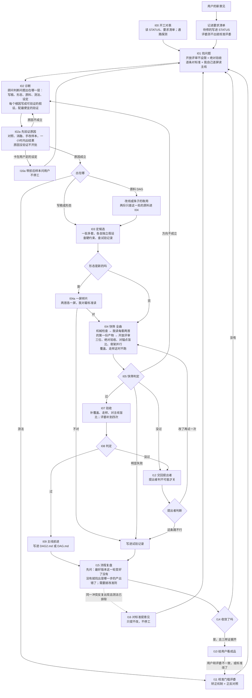

# 迭代准则：怎么把成品一步步改到标准要的样子

11-09 整理版。以前的图加六段补丁已并进正文；旧修订原文在 `迭代准则_修订历史.md`，整份旧版在 `迭代准则_备份_1109整理前.md`，两份都只是存档，和这里冲突时以这里为准。

**地位**：仅次于两份标准。标准定成品要做到什么，这份定怎么改流水线。
**谁能改**：我可以自己改这份准则（11-09 用户：“可能需要能够给他这个流程图自进化的权限”），但要照第八节的办法改；第八节列的三样东西不能动。
**严格按流程图走（11-11 用户：“我们希望严格按照他走的话就没问题 这两天的问题不就是因为没有严格按照他走导致的吗”）**：
- `STATUS.md` 最上面固定一行“现在在流程图哪一步、下一步是什么”，每走完一个节点就改。
- 进下一个节点之前，对一遍第四节这个节点要求的东西，齐了才走；要做的事在图上找不到，先补图（照第八节），再做。
- 每小时检查时同时对：现在在哪个节点，前面节点要求的产出有没有都做了（11-09 至 11-11 开放评审停跑、I15 没做，都是跳了节点）。

**压缩或接续之后**：先读 `STATUS.md`、`要求清单.md`、这份准则第一节的进化方式总览、第三节和第七节，再动手。

## 一、目标、两层和文件

成品只有一个：大众版视频（屏幕稿加渲染）。两层流水线：

| 层 | 做什么 | 标准 | 主线文件 | 怎么判断好坏 |
|---|---|---|---|---|
| DAG2 | 把定稿的线和珠子做成大众版屏幕稿和视频 | `_video_public_20261104/大众版标准.md`（只有用户能改） | `_dag2_video_20261104/DAG2.md` | 直接按大众版标准验收成品 |
| DAG | 新作品 → 珠子和线的定稿，只作 DAG2 的原料 | `_thread_evo_20261019/标准.md`（我可以凭端到端证据改） | `_thread_evo_20261019/DAG.md` | 只看端到端：两份只差这一处的定稿走同一条 DAG2，比成品 |

DAG 不单独宣布“收敛”。它的状态只写两样：现在用哪一版当原料；最近一次端到端证据是什么。

| 文件 | 管什么 | 谁写 |
|---|---|---|
| 两份标准 | 成品和原料要做到什么 | 大众版标准：用户。DAG 标准：我，凭端到端证据 |
| `迭代准则.md` | 怎么改流水线：流程、判定线、规则、怎么自己改自己 | 我，照第八节 |
| `DAG2.md`、`DAG.md` | 现行主线：节点、提示词、模型；修订记录只记收下的改动 | I09 |
| `试验记录.md`（两层各一份） | 每个试过的方案：假设、改了什么、结果、原因、结论 | I05、I08、I13 |
| `要求清单.md`（`_dag2_video_20261104/`） | 用户提过的每条要求：原话、做了没有、证据在哪 | 用户每提一条就记；每次汇报前对一遍 |
| `流程复盘.md`（`_dag2_video_20261104/`） | 每轮复盘的三问和流程改动的起因、预期、验证结果 | I15 |
| `用户判定.md` | 用户对成品的评判原话 | I10 |
| `STATUS.md`（两层各一份） | 现在在哪：主线版本、在跑什么、最近结果、等用户看的东西 | 每一步覆盖更新，不往后追加 |
| `设定登记.md`（`_dag2_video_20261104/`） | 每条设定：内容、写在哪几个地方（提示词、标准、评审说明）、谁定的（用户原话和日期 / 我 / 顾问 / 沿用旧版）、谁能改、当初为什么定、试没试过放开和结果。提示词、评审说明里每一条“不许”“必须”都要在表里找得到；查不到用户原话的记“我定的”，可以自己凭对照试验改；一条设定改了，表里列出的每一处同一步改完，用到的评委按第七节重新校准 | 我；新写或改任何提示词时对一遍 |

**进化方式总览（11-11 用户：“只要完全按照开发准则走 就能囊括所有的进化方式”）**。流水线只从下面这些方向变，每个方向都有入口、走哪一步、谁定；不在表里的改动不做，先把它补进这张表。

| 改什么 | 什么时候进来 | 走哪一步 | 谁定 |
|---|---|---|---|
| 屏幕稿的写法（写稿提示词、形态、机械约束） | I01 找到的问题出在写稿或形态 | I02 → I03 → I04 → I05 | 判定线（第五节） |
| 原料：线 | 问题出在线（打转、处境说不清、推得太满……） | I02 改线方案 → 两份只差线的原料走同一份 DAG2 | 端到端证据 |
| 原料：珠子的取用（去重、删泛泛的道理；珠子原文不改） | 问题出在珠子照搬（相邻段重复等） | 同上 | 端到端证据 |
| 门槛评委、盲比、覆盖、走样、机械约束 | 第七节“什么时候要校准” | I11 | 校准记录（第七节） |
| 开放评审的提示词 | 它反复把已定的取舍当头号问题、或漏掉用户看得出的大问题 | I11（只按第五节的写法校，不能关、不能改成不开放） | 前后对照 |
| 流程本身（这份准则） | 每轮 I15；用户指出流程问题 | I15（顾问找漏洞，我定） | 我，照第八节 |
| 提速（并行、去重复测量、在途数） | 每轮 I15 第 4 问 | I15 | 我；在途超过 15 问用户 |
| 哪一步用哪个模型（GPT-6、GPT-5.6、Argon、Gemini，或搭配） | 怀疑某一步换模型或搭配会更好；新节点选模型时 | 同一步只换模型、其余不变，两首同跑，端到端比（11-11 用户：“如果测出来某些环节某个模型比另一个更好 或者需要搭配的话 也是一种可能性 如果这个差别不大倒是无所谓 就用gpt就行”） | 判定线；差别在波动内就用 GPT |
| 大众版标准 | 同一冲突反复出现且测法已排除 | I16 | 只有用户 |
| 画面（渲染） | 内容做好以后（11-09、11-11 用户） | 暂缓；用户提的画面意见记进要求清单 | 用户看片 |
| 用户的每条新意见 | 用户提出 | 记进要求清单；待修的写进 STATUS 的“待修的问题”；判断属于上面哪一行。现有评委（开放评审、绝对验收、盲比）测不出这个问题的，就按第七节校准那个评委，不另做检查单（11-11 用户：“这些不应该只是status吗……我们准则里应该也不应该单独对他来做才对吧”） | 按所属那一行 |

## 二、硬约束（任何方案都要逐条查）

1. **泛化**：换任何作品、任何作曲家都能照样跑。提示词、评审、规则里不放具体作品的例子，也不写只针对眼前某处毛病的规定。每个提示词模板发出前过 `prompt_lint.py`，有作品原文就不发。
2. 成品全部由流水线产出，不经人手修改。
3. 构思经历（写线）时不看珠子；珠子最早在综合写线时进来。
4. 珠子的内容不改；DAG2 揉在一起时，意思不许走样（疑问写成断言、猜测写成确定都算）。
5. 允许联网。
6. **两首同跑、一起过**：每一步两首用同样的提示词、同样的步骤；一首过一首没过就是没过；不许拼版本。
7. 不在迭代范围：分段、A 稿、珠子原文、Center。珠子的取用可以改：相邻段几乎相同的要点只留前一段、泛泛的道理可以不用（11-10 用户：“这种两段一样的取前一段不就行了 这应该要改 dag 靠前的东西就行了吧 生产珠子的”；`r3/beaddedup.py`，两位都挑中才删）。

## 三、流程

## 四、节点

| 节点 | 做什么 |
|---|---|
| I00 开工对表 | 读 `STATUS.md` 和 `要求清单.md`；用一个最小请求探测通路；确认没有别的会话在改同一批文件 |
| I01 找问题 | 三个来源并列：开放评审（只找问题、不打分、不设限，它的用处就是补我想不到的）；绝对验收（门槛评委，按标准逐条判）；我自己对着标准逐屏读主线成品。结果和用户指出过的问题合在一起，写进 STATUS 的“待修的问题” |
| I02 诊断 | 先做四项定位，再请顾问提假设。四项同时跑，一小时内出结果；做出来的是诊断样本，不是候选，不进主线，不当成品。① **做得出来吗**：不管现有设定，让模型用最省事的办法写一份确实没有这个问题的样本（两首各一份），交给报这个问题的评委。评委仍然报，先校准评委（I11）；不报，说明问题是真的、也做得出来，记下这份样本没守哪几条设定、同时改了哪几处（改了不止一处的，再拆成只差一处的几份，11-12 CTRLe 同时改了“往前写”和“加事件”没拆开，结论站不住）。② **卡在哪条设定**：把 `设定登记.md` 里和这一层有关的设定一条一条单独放开，各写一份，其余不变；哪一条放开后问题消失，就是卡住的那条。属于用户的设定也可以先做松绑样本（11-12 用户答“可以”先试再问：只用来判断原因，不进主线、不改标准、不按放开后的设定跑批），拆到只差这一处。③ **从哪一层开始有**：拿同一个问题去查流水线每一步的中间产物（骨架、选中的路线、线、屏幕稿），找到它第一次出现的那一步，改法只在那一步和它之前找。④ **评委分得开吗**：同一版测两次，加上第 1 项的样本，看这个问题报得稳不稳。四项结果、试验记录、失败方案的提示词全文一起交给两位顾问（GPT-6、GPT-5.6，各自独立），再问根因假设，问法用 `line_r79o/r3/i02_诊断提问模板.txt`。交给顾问的材料里，设定不写成“约束”，写成“现在的设定（谁定的、试没试过放开）”，并写明“可以建议放开任何一条；属于用户的由我去问”（11-12 Fable 审查：11-11 晚两位顾问已说出“没有新的外部事实可经历”、冲突判“部分”，但问法把设定列成约束、只许交四个提示词，这条没变成动作）。顾问的回答里凡是说到设定或标准冲突的，原话记进试验记录。 |
| I02a 先验证原因 | 每一批开批之前都做，没有例外。“看到什么算成立、什么算不成立”在跑之前写下。四项里至少一项指出了位置（哪条设定、哪一层、还是评委），才按它出方案；每套方案写明它对应哪一项结果，`r3/gate.py` 开批前查这一栏，空着不放行。四项都没指出位置时不开批：把问题拆细或换一层再查一遍，并发一行给用户（11-12 起因：L34–L35 两批 12 套建立在没验证的原因上全失败）。 |
| I03 定候选 | 执行上和 I02 一次问完：每位顾问至少三套，互为独立假设（每套写针对的是 I02a 验证过的哪个原因、只改什么、和别套的区别、预期在哪个测量上看到改善；两套根因和改动相同的算一套；至少一套不能只是改提示词里的要求，要改结构、输入、分工或建议改设定——试验记录：在提示词里要求“不打转”从来无效）；交给顾问的材料带上试验记录里和这批相关的教训。一批六套左右（改线另算），优先只改一层。上一批的试验记录没写完，下一批不开（`r3/gate.py` 在开跑前查）。提示词由顾问出，我只查硬约束和查重；我自己想到的改法也交给顾问写成提示词，不自己直接写了就跑 |
| I04a 一屏样片 | 形态是新方向时先只写一屏（两首各一屏，挑内容最密的那屏）。我对着标准读，通过就写全曲。不跑全曲测量，不发给用户（11-11 用户：“你接下来不用给我样片了”） |
| I04 快筛 | 全曲，`r3/pipe_K27test.sh`。顺序固定：机械检查（免费）→ 我读每套候选两首各自的第一份产物（不拿一套代替别套），不对就停这一套并写明哪一条不对 → 开放评审（三位）、绝对验收（2 位）、对固定锚点盲比、骨架测并行。覆盖、走样这几项贵的不在这一段跑（11-11 一天白花 8.3 小时）。进了这一段的候选开放评审必跑；机械检查或我读就不过的，不再测。一批候选同时写、同时测 |
| I05 快筛判定 | 只用 I04 的结果，照第五节的线判：明显失败、接近、方向不成立、过（定义见第五节） |
| I07 验收 | 补：覆盖、走样（`r3/pipe_K27full.sh`）、和当前主线盲比；绝对验收和盲比各补到 4 次（GPT-6、GPT-5.6 各两遍）；开放评审不全部重跑，只在三位意见分歧或临界时重跑；截图评委搁置期间不做 |
| I08 验收判定 | 用 I07 补齐的全部结果，把第五节的过线条件重算一遍，不沿用 I05 的结论 |
| I09 主线前进 | 改动写进主线文件（节点、提示词、修订记录） |
| I12、I13 交回提出者 | 没过的候选（明显失败、接近、方向不成立都算）一律交回提出它的顾问，同一批的并行交回（`r3/handback_all.py`）：写明结果、哪个指标没过、开放评审原话。提出者判断“这条路不可能修成功”（写明为什么）就关掉；否则给改后的提示词继续试，已过的指标不许退。我不替提出者判“不可能”（11-12 用户：“一个评委提出问题并说可能解法 然后你修完 然后再评定完 就直接给他丢掉了吗……我之前说要给他继续试 除非这种解法被认为是不可能修成功”）。提速靠并行交回，不靠少交回；同一方案交回三次仍无改善，按自动绊线报给用户（不停）。 |
| I14 收敛判定 | 见第五节 |
| I10 给用户看 | 见第六节 |
| I11 校准门槛评委 | 见第七节 |
| I15 流程复盘 | 见第八节 |
| I16 对标准提意见 | 见第八节 |

## 五、判定线

**两种评委，两种用法（11-09 定）**
- 开放评审：不限制它说什么；三位（GPT-6、GPT-5.6、Argon）。它报的大问题参与候选过线（第五节第 4 条）和收敛。每个候选都跑（`r3/open_free.py`，进快筛脚本），任何时候都不许停、不许用别的测法代替（11-09 到 11-11 停了两天，人话问题一路没人报）。它不给标准、不给检查单，不许改成照条打勾的评委；可以校准：照 11-01 效果好的那版（`_thread_evo_20261019/e2e_open.py`）的写法，用大白话告诉它这是什么、想做到什么、哪些不算缺点，并写明“上面没说到的问题，只要觉得不对也照样要说”；不列禁区（11-11 用户：“我说的校准是校准开放评委的提示词啊 比如说我们的目的什么的……我担心他现在不开放了”）。改完用同一版前后对照验证：被说明不算缺点的那一条不再当头号问题，其余大问题照样报得出来（11-11 用户：“开放评审是可以去校准的……但是不能关啊……也不能把他改成‘不是开放’的评委”）。
- 门槛评委：从标准派生，用来淘汰候选和宣布过线。它必须先校准（第七节），看到的必须是观众看到的东西（扫读相关的判断看截图，不看完整文字稿）。
- 逐条校准（11-10 晚补）：门槛评委覆盖的每一条标准都要有自己的反面对照（只坏这一条），分得开才算这一条能测；没校准的条目，它报“没问题”不作数，要由别的已校准测法（如盲比分项）兜底。防止评委只学会认一种坏法：每条用两三种不同的通用改法造对照（脚本或通用提示词，两首同一套，不针对具体屏）；另留一组用户判过的真实样本不参与调提示词，只用来验，对得上用户才算校准过；这组样本集中记在 `_dag2_video_20261104/用户判定样本.md`（哪一版、哪一屏、用户原话、判好还是坏），用户每判一处就加一条。对照和样本只用来考评委，不进评委提示词、写手提示词和成品。起因：绝对验收第四版只用打转、分开、去音乐、笼统四个对照校准过，人话没有对照，大字不像人话一直测不出。
- 机械约束跟着标准走（11-10 晚补）：标准改了，写手的机械检查（字数、逗号、块数）要同时复查一遍是否还和新标准一致。起因：第 8 条改成只算大块后，“大块最多一个逗号、≤30 字”没放宽，逼写手把线的一句话劈成两条结论。

**候选过线（两首各自都要满足）**
1. 硬检查全过：泛化、正文无小节号、意思不走样、核心内容覆盖不低于现在的视频 w23（差距在测量波动内时同批配对重测，不拿单次平均数比大小）。
2. 绝对验收（按大众版标准逐条）：没有严重问题；中等问题比主线少，或者一样多但换成了更轻的。
3. 退步检查（盲比，两种先后顺序都测）：快筛时对固定锚点 K11g（各轮可比；人话这一项以它为门槛，11-10 用户判过），验收时再对当前主线。两个对象分开记，结果里写明比的是谁。没有“两位评委都稳定选旧”的情况。有的话看理由：
   - 理由对得上标准的某一条：算退步，走 I12 交回提出者。
   - 理由对不上标准，或者和标准相反：不淘汰，触发 I11 查评委。
   - 形态是新的候选，盲比总体输不直接淘汰，以第 2 条为准。
   - 逐项看（11-10 晚补）：总体之外，每个分项（人话、细腻、核心……）也单独看；某一项两首里有一首两位评委都输给主线，就算这一项退步，形态新也不豁免，交回提出者，并查有没有违背实验结论里已有的教训。起因：K25–K27 新形态盲比 human 一直 3:0–4:0 输 K11g，靠上一条豁免过线，人话一路掉，用户 11-10 晚判“不是正常人在说话”。

4. 开放评审（三位）：每首各列一张大问题清单（不同评委说的同一个根因并成一条），和主线的清单对照：候选不许出现主线没有的大问题，不能靠去掉一个、换进另一个来保持数目；主线已有的可以暂时还在，但不能更重（11-11 流程审查：开放评审报了大问题、候选照样过线，没有阻断；L33 流程审查两位都指出“只比数目”允许问题置换）。
5. 未校准的测法（现在是骨架、覆盖、走样，见第七节表）报的问题，我逐条对原文核过才算数；它们单独不能放行，也不能单独淘汰。

**改原料（线、珠子取用）的候选**：快筛时比两个对象，分开记——只差这一处的对照（看针对的那个问题有没有改善、有没有新出的大问题），和固定锚点（看离过线还差什么）。对只差这一处的对照，针对的问题有超出波动的改善、又没有新出的结构性大问题的，记“方向成立”：走打磨工序（N05e–g）以后再按候选过线 1–5 条和主线比，不因为“没打磨就输锚点”判明显失败；过线条件不变（11-12 Fable 审查：L32a 中等 53 对 88，被锚点盲比盖掉）。

**I05 的四种结论**
- 明显失败：违反硬约束；或绝对验收中等问题明显多于主线、开放评审出现主线没有的结构性大问题、盲比某项两首都输，而且不是一两处能改好的。
- 接近：硬约束全过，有正面证据（某个主要指标好过主线、超出波动），剩下的问题能落到一两处具体的地方。
- 方向不成立：同一个根因在这个方向的独立候选上反复出现（例如写线层 5 套都打转）。交回提出者（由提出者判断能不能修），同时回 I02 出新方向，两件事并行。
- 过：上面候选过线 1–5 条全满足。
- “方向对”只指上一次在预先说好的主要指标上有超过波动的改善，听着合理不算。

**问题的轻重（开放评审和绝对验收通用）**
- 大问题：结构性的问题——打转、看不懂这一屏在讲什么、意思错、人话整体不像人说的、核心说不清、语体和音乐整体不配——只要有一位开放评审排在前三，或两位以上评委都报；绝对验收的严重和中等里属于结构性的那几类。排在前三但只是一处措辞、一处小重复的，不算大问题（排名只是先后，不定轻重）。
- 轻微：不影响理解和扫读的个别措辞、标点、一处非核心的小重复；改了也不会让观众的读感明显不同。
- 其余算中等。

**收敛**
实际做出一版，开放评审（两首、三位评委）挑不出大问题，绝对验收剩下的都只是轻微（11-11 用户：“最后开放评审挑不出什么大问题才是收敛”）。“几轮候选都没过”只说明这条路走不通，要换路或查测法，不算收敛。

宣布收敛或说“定稿”之前，三样证据要齐，缺一样就只能说“当前最好的一版，还差什么”：
1. 用到的门槛评委都有校准记录（正反对照分得开、同一版两次接近）。
2. 写明这一版相对上一次交付改了多少（新写了多少字、哪些屏变了）。
3. 我自己逐屏读过，读的结论和评委一致；不一致先走 I11。
4. `要求清单.md` 里仍然有效的每一条都标了状态：已做并有证据、暂缓（写明为什么，比如画面）、待用户定；没核实的不算满足，汇报时把暂缓的单独列出来（11-11 L33 流程审查两位都提）。画面暂缓期间，说清楚是“文字稿这一层”的结果，渲染没验过。

**DAG 的改动**
只按端到端证据收下：两份只差这一处的定稿各走同一条 DAG2，按上面的线比成品，两首都有差别才算。DAG 层自己的测法（推进对比、贴 Center 对比、DAG 绝对验收）只作诊断。

## 六、什么时候找用户

只在这几种情况，其余自己往前做（账号保护自动切换、两个都保护就等 50 分钟重试，都不问）：

1. **宣布收敛之前**（I10）：带版本名的成品、测量结果、剩余问题、这版改了多少。
2. **我读的结论和校准过的评委相反**，两位顾问也没法定。
3. **标准没规定的事**（主要是画面怎么分区这类）。
4. **对标准的意见**（I16）。
5. 账号、硬约束取舍。

**判断要不要找用户，只看两点同时成立**：这件事靠标准和校准过的工具定不了；定错了后面会白干好几个小时。其余都自己定。

**自动绊线（防止在没用的东西上干很久，触发就发一行给用户，不停工）**
- 同一个方向连续两轮、或累计约 3 小时，最好版本的中等问题数没有减少：报“试了什么、为什么没用、下一步换什么”，并回到 I02 让顾问换方向。
  - 绊线按问题算，不按方向算。`STATUS.md` 的“待修的问题”表加三列：第一次报出的日期、活过了多少个版本、试过哪几类改法各几次（提示词里的要求、生成结构、输入、分工、设定、测法）。同一个问题、同一类改法失败两次，下一批的新方案要以更上一类为主，顺序是：提示词里的要求 → 生成结构和输入 → 分工 → 设定（I16a）→ 测法。交回提出者的旧方案不受这条限制，照样交回（11-12 Fable 审查：打转 11-01 就记在案，活过 30 多个版本，没有一条规则按“问题活了多久”触发）。
  - 每小时检查时都要对这一条（这个方向已经几小时、最好版本的中等问题有没有减少），到点就停，不等这一批跑完（11-10：K25、K26 做了 8 小时多才停）
  - 两个指标此消彼长超过一次交回：先查这两个指标的测法和对应的标准条文（必要时按 I16 向用户提意见），再决定要不要继续改写法（11-10：覆盖把三分之二的单元算成核心、第 8 条把小字算进阅读量，换了三次写法才查）
  - 请顾问出方案每人至少三套、互为独立假设；每一批至少带一个只差原料的对照，DAG 不落下
- 连续两轮的候选相对主线几乎没有新写的内容（只是删和挪）。
- 我读的结论和评委相反。
- 通路连续零秒失败、或一小时没有任何调用完成。

找用户不等于停工：发出去以后继续做不依赖答复的部分；约半小时没有答复，就按自己的最好判断往下做，并标明“未经用户确认”，用户回来后再对。汇报时 DAG 和 DAG2 分开说，没测完就说做了一半。

## 七、评委和测法的校准（I11）

任何时候有证据说某个评委或测法量得不准，都可以校准，不必等下面的情况；下面这些情况是必须校准。

**现役评委和测法**（每轮 I15 对一遍这张表；新增一个就要写明它替代谁，见第九节第 6 条）

| 评委或测法 | 管什么 | 用法 | 怎么校准 | 现状（11-11） |
|---|---|---|---|---|
| 开放评审（`r3/open_free.py`，GPT-6、GPT-5.6、Argon 三位） | 补想不到的问题；收敛的最终判据 | 每个候选必跑；候选过线时大问题不比主线多（第五节第 4 条） | 第五节的写法；同一版前后对照 | 第三版（按目的写）11-11 对照通过：K28b、K11g 上“没有发生具体的事”不再当头号问题，打转、心理分析腔、出戏等照样报出；Argon 11-11 在 K28b 上报出两位 GPT 都漏的问题（“对方”26 次、“上回这回”汇报体、语体和音乐不配、几处小字方向反了），加为第三位 |
| 绝对验收（`r3/openabs5.py`，5b） | 按标准逐条找问题 | 门槛 | 每条标准各有反面对照，另留用户判过的样本 | 人话：电报腔对照分得开，方向和盲比、用户一致；“跳”测不出；其余条目沿用第四版的四个对照 |
| 盲比（`r3/vs5.py`，对固定锚点） | 退步检查，总体和七个分项 | 门槛 | 自比判平、只切块判平、电报腔对照稳定选原版 | 已校准（11-10） |
| 骨架测、覆盖（`units*.py`）、走样（`faithful.py`） | 只看大字明不明白、内容丢没丢、意思变没变 | 骨架、覆盖诊断；走样硬检查 | 各要一个“只坏这一项”的对照 | 没有反面对照 |
| 机械检查（`r3/fragwrite.py`） | 字数、块数、标点、每秒字数 | 写稿时自动退回 | 标准一改就复查 | std9（11-10 晚放宽） |
| 截图评委 | 看渲染画面扫不扫得动 | 暂不用 | 正反截图对照 | 搁置 |

**什么时候必须校准**
- 新写的门槛评委，用之前。
- 目标或形态变了（例如从读变成扫、屏幕分区变了），原来的评委还适用吗。
- 淘汰理由对不上标准或和标准相反。
- 我读的结论和评委相反；同一版两次测的差距比两版之间还大。
- 用户和评委不一致，或标准改了。以用户为准，是对齐评委，不是说服用户。
- 开放评审反复把已经定下的取舍当头号问题，或者用户看得出的大问题它报不出来。
- 两个测法给出相反的结论（例如绝对验收说没有打转、开放评审说打转是头号问题）：先查哪个测不出，测不出的那一条在表里标明，以另一个为准。

**怎么校准**
1. 正反对照：用已知有差别的版本或人为造的对照，分得开；同一版测两次接近。对照要覆盖这个评委负责的每一条标准，只验证了其中一条的，其余几条不算校准过。
2. 怀疑评委量偏时走矫正机制（`_video_public_20261104/judge_check.py`）：材料交给 GPT-6、GPT-5.6 各自独立查。A 轮不给我的结论；B 轮审我的改法。两位独立指向同一根因才改。不能因为结果不合我意就改评委。
3. 校准用的提示词里不放被测版本的原句。
4. 校准记录写进主线文件的测法一节：对照是什么、结果、日期。

## 八、流程自己改自己（I15、I16）

**I15 流程复盘**：每轮结束（一批候选有了结论）做一次，写进 `流程复盘.md`。先回答第 0 问，再答五问：
0. 先填记分表（每轮必填，写在这一条复盘最上面）：最好版本对上一轮的绝对验收中等数（同批配对）、开放评审大问题清单、盲比，各是变好、没变还是变差；头号问题活过了多少个版本，这一轮有没有做四项定位、哪一项指出了位置；这一轮的调用里诊断样本占多少、候选占多少；到期的流程改动（见台账）各自预期的数字兑现了没有。最好版本没变好时，只回答一件事：这一轮所有没成的方案，共同没动过的东西有哪些（设定、输入、哪一层、哪个评委），逐条列出，每条排进下一轮的四项定位（11-12 用户：“如果他这种一天没有跑出问题不是说明本身的自指涉没有能够成功去优化自己？”）。
1. 这一轮的调用时间花在哪了？哪一步最长、哪一步是白花的？（从 `runs/calls.jsonl` 按阶段统计）
2. 哪次淘汰或哪次通过，事后看是错的？为什么当时没发现？
3. 哪条规则这一轮没被执行？是规则不合理，还是没有东西提醒？
4. 下一轮怎么更快？（11-11 用户：“每次结尾他这个评定流程而言 也可以再加一个如何加速的”）哪些步骤互不依赖、可以同时跑；哪些测量已被别的取代、可以去掉或合并；两个账号这一轮报没报保护、在途数要不要调（上限 15，报一次保护就退回上一档）；加评委不减少轮次，多出几套独立方案同时跑才省轮次。
5. 以前的教训这一轮有没有再犯？把 `试验记录.md` 和记忆里的实验结论逐条对这一轮的候选（例如压缩改写丢人话、整篇重写输、机械约束塑造写法）；再犯了的，查为什么没拦住（11-11 流程审查：这两天的人话退步就是旧教训再犯）。

**流程审查交两位顾问（11-11 补，11-12 改）**：复盘不只我自己做。每轮复盘把准则、`流程复盘.md`、`要求清单.md` 里最近的用户原话、调用统计、`试验记录.md` 最近几轮全文（让它看得到“好几套死在同一个原因上”这种规律）和这一轮的结果交给 GPT-6、GPT-5.6，第一问就是“这一轮为什么没进步、流程哪一步该改”，提速放在后面且不能削弱效果；各自独立找流程的漏洞（哪条规则让错的东西过了线、哪一步没执行、缺什么测法）。起因：11-10 的三个漏洞（新形态豁免单项退步、门槛评委没逐条校准、标准改了机械约束没跟上）都是用户问出来的，我自己的复盘没发现。谁来定：顾问提出的漏洞全部由我判断改不改，不按几位提出来算（11-11 用户：“他们提出了的漏洞 全都你来判断就行 不用管什么两位还是一位 因为他们没有全局视角”）。顾问只看得到交给它们的材料，我有用户原话和全部历史。每条都要在 `流程复盘.md` 里写明采纳或不采纳和理由；不采纳的，下一轮结果出来后回头看当时判得对不对。放宽类、大众版标准、收敛定义照下面的规矩。 交给顾问的材料不截尾：这一轮每套失败方案的提示词全文、产物、四项定位的结果、顾问当时自己的诊断原话都给。问法里加两条：每条建议写明它要改善记分表里哪一个数字、预期怎么变；另问“这一轮所有失败的方案共同没动过的东西是什么”。另加一位没出过这批方案的（新会话即可）只答后一问，只给它方案和产物，不给我的归纳。

**改准则的办法**
- 直接改正文和图，不在文末加补丁；旧说法删掉。修订记录只写一行，细节写在 `流程复盘.md`。
- 每条流程改动在 `流程复盘.md` 顶部的台账里记一行：起因（证据）、改了什么、预期下一轮记分表里哪一个数字怎样变、哪一轮到期、核对结果、留还是撤。到期没核对的，下一批不开。预期没兑现的撤回。为同一个目的一轮最多收两条改动，其余排队；只是补记录、补对表的不限（11-12 Fable 审查：L33 一次收 13 条，其中“只交回一次”有害，事后分不出哪条有用）。
- 判断一条改动是不是放宽，不看它叫什么，只回答一个问题并写进台账：照这条改了以后，有没有哪一次本来会做的试验、测量、交回不做了，或者哪个候选会更早被关掉？有，就是放宽类；碰到用户定的规矩的，只能去问用户。没有，才算收紧类或提速类。
- **收紧类、提速类**（多读一步、多一项校准、并行、合并重复调用、缓存）：可以直接改。提速只能是“效果不变、更快”；凡是让候选少试几次、少测几项、早点关掉的（减少交回次数、只对部分候选交回、早停淘汰），都算放宽，不算提速（11-12 用户：“他为了提速怎么把我们提效果用的东西都给搞掉了呢”——11-11 晚把“只交回一次”当提速改进了准则，砍掉了交回提出者）。
- **放宽类**（放宽门槛、减少测量项、改怎样算过线、减少试的次数）：两位顾问独立印证后才改，并在下次汇报时单独告诉用户（不混在采纳清单里）。
- **不能动的（只有用户能改）**：大众版标准；“收敛看成品”的定义（第五节）；最后由用户看片；以及用户定下的这些规矩——没过的方案交回提出者、提出者判不可能才关；开放评审每个候选必跑、不许关、不许改成不开放的；两首一起过；评委有问题校准评委、不另做检查单。顾问的流程审查碰到这些，只能当“建议问用户”（`r3/procreview.py` 的提示词里列着这份清单）。

**I16 分两种**（11-09 用户：“有的时候也要提出对于比如标准的意见吧？（如果确信度非常高）”；11-12 按 Fable 审查拆开）
- **I16a 某条设定卡住**（从 I02 第 2 项来）：条件——两首的松绑样本都显示单独放开这一条后问题明显消失、只差这一处、评委分得开、同一版重测也一样（很有把握才问：11-12 用户答“尽量少”问）。同一个问题最多问一次。交给用户：哪一条、原话出处、放开前后的同一段样本各一份、放开以后评审新报了什么问题、建议放开到什么程度。等答复期间照现行设定做，不按放开后的设定跑批；用户的回复含糊时问清楚，不当成同意（11-12：把“能放款”当成同意放宽，改了标准、跑了一批，用户：“我什么时候同意放宽了”）。
- **I16b 标准条文之间冲突**：条件照旧（两首、至少两套独立候选都出现；走过 I11；两位顾问独立认为是标准本身的问题）。交给用户哪一条、证据、建议的改法、改了能解决什么；只提不改，等答复期间照现行标准做。
- DAG 标准不在此列，照第一节由我凭端到端证据改；改之前同样先有拆到只差一处的松绑样本；`设定登记.md` 里记为用户定的，照 I16a。

## 九、提速

依据：11-08 到 11-09 两天共约 228 个调用小时，约九成花在测量上，写稿约一成。测量里最大的几项：整屏珠子覆盖 39 小时、盲比 35 小时（1300 多次）、意思走样 32 小时、绝对验收 23 小时、整屏人话 19 小时、意思单元覆盖 15 小时。写稿单次调用九成在 20 分钟内，但失败重试白花了约 3 小时。

1. **一屏先行**：新形态先做一屏，不对就不写全曲、不跑测量（I04a）。
2. **读在测前**：机械检查和我自己读都不花调用，放在所有测量之前；读出明显问题就停。
3. **贵的测量放后面**：快筛只用 2 位评委；整屏覆盖、走样、整屏人话这几项贵的，只给过了绝对验收和退步检查的候选做；全套 4 位评委只在验收时补。
4. **没有结论价值的不测**：已经淘汰的候选，后续测量立刻停；失败版本不默认买全套诊断。
5. **并行**：一批候选同时写、同时测；写稿和测量、DAG 和 DAG2 的事并行；两个账号按用户给的上限用满，不自己降。
6. **现役测法有上限**：现役测法列在主线文件的测法一节。新增一个测法，就要停用一个，或者写明它替代谁。同一件事有几种口径的（例如三种覆盖），在复盘里定一个主口径，其余只在有疑问时用。减少测量项属于放宽类，照第八节办。
7. **只重测变了的部分**：逐屏的测法（截图评委）按屏缓存，画面不变就沿用；整首的测法不切段（切段测过，和整首对不上）。
8. **通路先探测、不空转**：每批开跑前用一个最小请求探测；连续 3 次零秒失败就停下查原因并报告，不让流水线空转重试。
9. **不守着**：只等完成通知；进度只在整首完成、出错、有结论时报。
10. 调用按编号缓存：改了提示词必须换调用编号前缀，否则会读到旧结果。

## 十、其余规则

1. 只有一条主线，成品只从主线出；不另起一条“看着更好”的线去修补。
2. 找改法要大胆，判定要严，只比同一位置、只差一处的版本。
3. 局部修补和整篇重写都是候选来源，哪个都不是默认。局部修补连续两轮只带来删减、没有带来新写的内容时，回到 I02 让顾问出写稿层的方案。
4. 守护清单：评委说过“删了算退步”的内容，下一轮修补不许再删。
5. 跑之前核对输入（打印读进提示词的条数，0 条就停）。
6. 只报测到的；没测完就说做了一半。
7. 不用 git、不开 worktree：并行靠各自的版本名；交给 Codex 的活写清只动哪些文件。
8. 停进程用 PowerShell 按命令行精确停；等后台任务以进程结束为条件。

## 修订记录

- 11-02 建立；11-02 至 11-08 的六次修订见 `迭代准则_修订历史.md`。
- **11-09 整理**（用户同意）：补丁并进正文；流程图改成两层共用一张，DAG 只按端到端证据改；绝对验收为主、盲比只查退步；收敛要三样证据；加 I04a 一屏样片、I15 流程复盘、I16 对标准提意见；加第六节（什么时候找用户）、第八节（自己改自己）、第九节（提速，带调用统计）；加 `要求清单.md`、`流程复盘.md`。起因见 `_dag2_video_20261104/流程复盘.md` 第一条。
- **11-11**：加进化方式总览（第一节）、现役评委和测法总表（第七节，任何时候都可校准）；开放评审进 I01、I04（体检单当天撤掉，用户指出过的问题写进 STATUS 待修，评委测不出就校准评委）；硬约束 7 写明珠子的取用可以改；样片不再发用户。旧版存档 `迭代准则_备份_1111补进化总览前.md`。
- **11-11（流程审查后）**：两位顾问审流程（`r3/procreview.py`，`r3/s24/procrev_K29_*.txt`），我采纳：开放评审进候选过线；定义大问题和轻微；收敛改为开放评审三位挑不出大问题；候选数统一为每位顾问三套；I07 写明评委；I15 加第 5 问（旧教训再犯）；用户判定样本集。取舍理由在 `流程复盘.md` 第 5 条。旧版存档 `迭代准则_备份_1111流程审查前.md`。
- **11-11 晚（L33 流程审查后）**：I04 分两段（覆盖、走样挪到 I07）；开放评审过线改成按根因对照清单、不许问题置换，大问题限于结构性；I05 四种结论的定义；I12 只交回一次，方向问题回 I02 并行；I05、I08 分开；盲比快筛对锚点、验收对主线；未校准测法不单独放行或淘汰；收敛证据加要求清单；I16 → I01；开批前 `r3/gate.py` 查试验记录。取舍在 `流程复盘.md` 第 6 条。旧版存档 `迭代准则_备份_1111晚流程审查L33前.md`。

- **11-12（用户纠正）**：I12 改回“没过的一律交回提出者，提出者判不可能才关”。11-11 晚按顾问流程审查改成“只交回一次、方向问题不交回”，违背了用户原来的规矩，L34–L35 共 12 套被我直接判掉、没交回。备份 `迭代准则_备份_1112交回规则前.md`。

- **11-12（用户同意）**：加 I02a 先验证原因（原因没验证不开批，根在设定马上问用户）；I02 诊断要给可验证假设和最便宜的验证；I03 至少一套改结构而不只改提示词要求；I15 加第 0 问“最好版本变好了没有”；流程审查顾问读试验记录、第一问问“为什么没进步”；流程改动下一轮回头验收。备份 `迭代准则_备份_1112自我改进前.md`。

- **11-12（Fable 流程审查后）**：I02 改成四项定位（做得出来吗、卡在哪条设定、从哪一层开始有、评委分得开吗），设定不写成约束；I02a 每批必做、方案对应定位结果；I16 拆成 I16a（设定卡住，带前后样本当场问，回复含糊不当同意）和 I16b；加 `设定登记.md`；绊线按问题算、改法类别升级；I15 第 0 问改记分表、只答“共同没动过的东西”；流程改动台账、到期核对、一轮同一目的最多两条；放宽按后果判；改线候选比只差一处的对照、方向成立先打磨再比。取舍在 `流程复盘.md` 第 9 条。备份 `迭代准则_备份_1112Fable审查前.md`。
